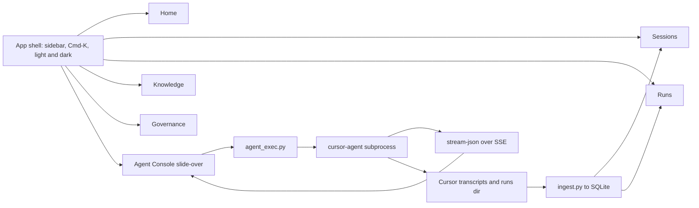
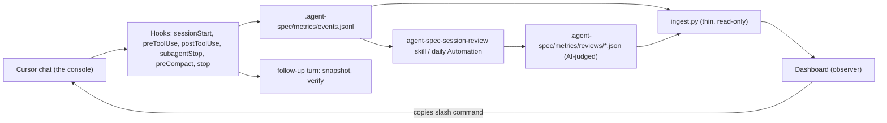

# Agent-Spec Control Plane v2 — Dashboard Overhaul Plan

> **Document type:** Product architecture and UX plan
> **Scope:** `bin/aspec_platform/` (server, ingest, UI) and the docs that govern it
> **Status (2026-11-13):** v3 request-trace plan proposed in §14 (DEC-16); the §14.1 review found v2 rows closed without meeting acceptance (CP-015, CP-021, CP-025, CP-031, CP-040, AF-001). Previous status line, kept for history — v2 Control Plane fully shipped & v1 retired (2026-11-07): React SPA as the sole UI bundle, read/action APIs, Console prompt composer, 5 spaces, status bar with graph/doctor/hook dots, 7-day sparklines, guided 5-step tour, savings calculator, context gauge, gaps audit, team-fact filter, and S-004 nudge logging (all CP-002–050 complete; CP-042 legacy v1 retired). Phase 4/5 panels deferred per MASTER-PLAN. AI-first realignment (DEC-15, §13): observer & governance focus.
> **Supersedes:** v1 of this file (2026-11-05 draft)
> **Related:** [`docs/DASHBOARD.md`](docs/DASHBOARD.md) · [`todo-plan.md`](todo-plan.md) Slice 6 · [`demo.md`](demo.md) · [`docs/IMPLEMENTATION-GUIDE.md`](docs/IMPLEMENTATION-GUIDE.md)

---

## Executive summary

The dashboard becomes the one place where people **see, try and drive** agent-spec:

1. **See** every real capability of the harness: digest, Graphify, guard, bounded memory,
   subagents, the 9-gate SDLC, workflows, personas, the learning flywheel, receipts.
2. **Try** it through a guided three-minute tour that follows `demo.md`, on real data or a
   clearly labelled demo seed.
3. **Drive** it from an **Agent Console** that starts a new Cursor session or continues an
   existing chat, launches workflows, and streams the reply live.

Four design rules:

- **AI-first, thin dashboard (DEC-15).** Cursor is the console. Skills and hooks do the
  work and the judging; the dashboard reads their artifacts. Code only where it must be
  exact, fast or secret-safe. See §13. Where §4.6 / §6 / §12 conflict with §13, §13 wins.
- **Honest by construction.** Every number carries a provenance badge: *Measured*,
  *Estimated* (formula shown) or *Demo seed*. No number appears without a query behind it.
- **Calm by default.** Five spaces, at most four KPI cards per screen, one primary visual,
  detail in drawers.
- **Local-first stays true.** Loopback only, per-launch token, no upload, Python stdlib
  server. The UI is a prebuilt static bundle, so running it needs no Node.

---

## 1. Review of v1 (why it was rewritten)

| Problem in v1 | Impact in a demo | v2 response |
|---|---|---|
| Invented figures and features: "$1,428.60 saved", "0 security breaches", "AST 3-way merge", "diffs validated by Graphify's parser", "Injected & Adhered" detection | One challenged number discredits the whole story | Provenance badges; only features that exist in code are shown; future ideas are labelled *Roadmap* |
| Silently contradicted DEC-12/DEC-13 and the `dashboard-server-guards` memory fact (GET-only, no SSE, no third-party UI) | Reviewers reject it as off-plan | Explicit **DEC-14** that names what it reverses (§3) |
| Conflated the **6-gate implement pipeline** with the **9-gate SDLC** | Misrepresents the core governance story | Both shown separately in Governance |
| Missed the repo's strongest assets: workflows + hub-runner run records, 11 personas, receipts/ROI, doctor/selftest, blast radius, symbols/callers (D-007), backlog CLI, intent to REQ trace, tech debt, MCP filter | The dashboard undersells the product | Full feature map (§2) |
| No way to act: no new session, no resume, no workflow launch | Passive autopsy viewer | Agent Console (§4.6) |
| Six hubs, eight headline features, Three.js + D3 + Mermaid + Tailwind + Vis, 4-week Gantt | Cluttered, heavy, slow to ship | Five spaces, one console, four milestones |
| Hardcoded model prices (Claude 3.5 Sonnet, GPT-4o) | Out of date on day one | Editable `.agent-spec/pricing.json` |

---

## 2. Feature map: every real capability gets a surface

| Harness capability | Source in repo | Space | What the user sees and does |
|---|---|---|---|
| Session digest | `bin/agent-spec-digest.py`, `hooks/cursor-session-start.py` | Home | "What the agent knew at start" card; bytes injected |
| Graphify graph, symbols, calls | `bin/graphify-build.py`, `bin/graphify-cli.py`, `.agent-spec/graph/knowledge-graph.json` | Knowledge | Force graph; search a symbol; see callers |
| Blast radius | `bin/agent-spec-blast-radius` | Knowledge | Click a file: dependents glow; count shown |
| preToolUse guard + S-002 quarantine | `hooks/cursor-pre-tool-use.py`, `quarantine_events` | Governance | Blocked/nudged events, reason, tool |
| MCP filter | `bin/agent-spec-mcp-filter.py` | Governance | Tools exposed vs filtered |
| 6-gate implement pipeline | `skills/agent-spec-implement/` | Governance, Runs | Gate audit per change, red/green |
| 9-gate SDLC + REQ trace | `bin/agent-spec-gate.py status/trace`, `.agent-spec/pipeline/` | Governance | Gate rail; REQ-to-artifact trace |
| Intent capture | `skills/agent-spec-intent/` | Governance | Intent to REQ lineage at the head of the rail |
| Bounded memory | `bin/agent-spec-memory.py`, `memory_facts`, `fact_injections` | Knowledge | Fact browser by type; sessions that received each fact |
| Learning flywheel | `.agent-spec/experience.jsonl`, `experiences` | Knowledge | Candidate to trusted to skill journey |
| Subagents | `.cursor/agents/`, `subagent_runs` | Runs, Sessions | Subagent health; bytes kept out of parent context |
| Workflows | `skills/agent-spec-wf-{rca,pr-review,fix-plan,eval,example}`, `skills/agent-spec-hub-runner/`, `.agent-spec/runs/*/events.jsonl` | Runs | Launch, watch the live step graph, inspect each step |
| Personas | `.agent-spec/personas/` (11 roles) | Console, Knowledge | Pick a persona before chatting; catalog with Absolute Rules |
| Skills catalog | 39 skills under `skills/`, `insights.skills_catalog` | Knowledge, Console | Browse; one-click insert into Console |
| Token measurement + compare | `bin/agent-spec-tokens.py`, `savings.compare` | Sessions | A/B compare two sessions |
| Session grading | `cursor_sessions.evaluate_session` | Sessions | Grade badge + three coaching tips |
| Receipts + ROI | `bin/agent-spec-receipt.py`, `bin/agent-spec-roi.py` | Governance | Rollup and CSV/JSON proof-pack export (D-014) |
| Install health | `bin/agent-spec-doctor.py`, `bin/agent-spec-selftest.sh` | Governance | Health card with failing checks |
| Backlog | `bin/agent-spec-backlog.py` | Governance | Open rows by slice |
| Tech debt | `skills/agent-spec-debt/` register | Governance | Open items, severity |
| Gaps rules (D-022, v1 parity) | `insights.gaps`, `/api/gaps` | Governance, Home | "Caught by the harness" tab; Home shows the open count |
| Savings calculator (D-010, v1 parity) | `savings.savings`, `parse_weights`, `/api/savings` | Sessions | Naive whole-file vs graph context, editable weights, next to A/B compare |
| Learning trend (D-012, v1 parity) | `insights.home` | Home | Sparkline inside each KPI card (no extra chart) |
| Graph freshness (D-006) | `graph_stats`, `.agent-spec/graph/.status.json` | Status bar | "graph 2h old" chip; amber past 7 days |
| Context threshold nudge (S-004) | `hooks/cursor-pre-tool-use.py` `token_threshold()`; **not logged today** (CP-050) | Sessions, Console | Context gauge with the threshold marked; nudge events in the guard log |
| Hooks and git-hooks status | `merge-hooks-json.py`, `manage-git-hooks.py` `check_hook` | Status bar | Dots for sessionStart / preToolUse / sessionEnd / git reindex |
| Session-end receipts | `hooks/cursor-session-end.py` -> `metrics/daily.jsonl` | Governance (proof pack) | Already counted in receipts; no new surface |
| Team facts | `memory_facts.scope` (`local` / `team`) | Knowledge | Filter chip on the memory list |
| Snapshot size and rotation | `SESSION-SNAPSHOT.md`, `agent-spec-memory.py snapshots` | Health card | One line: size, sections, "rotation due" |

Ideas from v1 that have no data source today (semantic fact-adherence detection, citation
precision scoring, OTel export) are kept in §9 *Roadmap*, never shown as live. So are the
active terse mode (`raw-code` / `raw-code-full`, not recorded anywhere) and reference lint
results (`agent-spec-lint-refs.py` has no `--json` output).

---

## 3. Decision record: DEC-14 (to add to `IMPLEMENTATION-GUIDE.md`)

**DEC-14 — Interactive control plane (2026-11-06).**

- **Frontend:** Vite + React + TypeScript + Tailwind in `ui-src/` at the package root (not
  under `bin/`, because `install.sh` copies `bin/aspec_platform` whole into every registered
  project), built into `bin/aspec_platform/ui/dist/`, which ships with the package. `serve.py`
  serves the bundle. Node is a contributor-only build tool; end users never need it.
  The existing `ui/index.html`, `dashboard.js` and vendored Chart.js are deleted only after
  milestone 4 reaches parity.
- **Libraries (vendored by the build):** `@xyflow/react` (step graphs), `react-force-graph`
  (2D by default, 3D toggle), Recharts, `cmdk` (command palette), `lucide-react`,
  `framer-motion` (motion only where it explains state).
- **Execution:** the server may spawn the local Cursor CLI (`cursor-agent`) for the Agent
  Console and workflow launches, behind the guards in §6.3.
- **Reverses:** DEC-13's drop of D-020.1 (SSE) and D-029 (write endpoints); the
  `dashboard-server-guards` memory fact (GET-only). **Partially reverses** DEC-12's drop of
  `CursorCliRuntime`, but only as a thin subprocess launcher. Workflow logic stays in skills
  run by the hub-runner; `agent-spec-run.py` still only records state.
- **Unchanged:** stdlib-only Python, loopback bind, per-launch token, CSP, `bin/` core
  never imports `aspec_platform`, one server process, no file-serving path outside the bundle.
- **SPA Routing & CSP:** `serve.py` routes any non-API path (`/sessions`, `/runs`, etc.) to
  `ui/dist/index.html`. CSP is tightened for React + canvas:
  `default-src 'none'; script-src 'self'; style-src 'self' 'unsafe-inline'; connect-src 'self'; img-src 'self' data: blob:; worker-src 'self' blob:; frame-ancestors 'none'; base-uri 'none'; form-action 'none'`.
- **Rejected:** Next.js (needs a Node server; static export adds nothing over Vite);
  Rust (no gain for a localhost UI, adds a toolchain).

---

## 4. Information architecture



Progressive disclosure on every screen: **headline** (one sentence + up to 4 KPIs), then
**visual** (one chart or graph), then **inspector drawer** (raw tool args, outputs, rows).

### 4.1 Home — "the story"

- Four KPIs, each with a provenance badge and a 7-day sparkline (the D-012 trend):
  **tokens kept out of context**, **cache-hit rate**, **gate pass rate**, **memory facts
  reused**. A small "N caught by the harness" link under the KPIs opens the Gaps tab.
- "How it works" strip: five tiles (Digest, Graph, Guard, Memory, Subagents). Each tile
  shows one live number and deep-links into its space.
- **Guided Demo Tour** button: spotlight overlays that follow the `demo.md` three-minute
  script in five focused steps:
  1. *Session Digest:* the injected block and its live byte count (1,841 B on this repo
     on 2026-11-06; the tour reads it, never hardcodes it).
  2. *Graphify:* blast radius of one file; bytes of the `context` answer vs bytes of the
     files it replaces, both measured on the spot. Python is parsed with `ast`; other
     languages use regex, so the copy says "graph", not "AST".
  3. *Input Discipline:* `preToolUse` events from `quarantine_events`: S-002 blocks and
     whole-file-read nudges.
  4. *SDLC Rails:* 6-gate implement audit and 9-gate rail with the REQ trace.
  5. *Bounded Memory & Console:* facts and their injection counts; opens the Console with a
     prefilled Ask-mode prompt.
  Every number in a tour step carries the same provenance badge as the KPI it comes from.
- Recent activity: last 5 sessions and runs, one line each.

### 4.2 Sessions

- List with search (prompt text, file, tool), filters (workspace, grade, date).
- Detail: grade badge + three coaching tips, turn timeline with tool and subagent chips,
  **replay scrubber** (play, pause, 1x/2x/5x) over `build_pipeline_stages`.
- **Context gauge** in the detail header: peak context tokens against the S-004
  threshold (80,000 by default), with nudge points marked once CP-050 logs them.
- **Token flow** tab in the detail drawer (lazy): a Sankey of where tokens went (digest,
  tool output, file reads, model output). Badged *Estimated* where the split is inferred.
- **A/B compare:** pick two sessions; deltas for tokens, tool calls, whole-file reads,
  duration.
- **Savings** tab beside compare: the v1 D-010 calculator, naive whole-file vs graph
  context with editable weights.
- **Continue this chat:** opens the Console bound to that chat (`--resume`). Shown only for
  chats the CLI can resume. IDE composer ids come from Cursor's `composerHeaders` table and
  are `[CONFIDENCE: LOW]` as CLI resume ids; spike CP-001 decides. If they are not
  resumable, the button reads "Continue in Cursor" and opens the IDE instead.

### 4.3 Runs & Workflows

- Launch cards: RCA (Jira key), PR review (branch), Fix plan (RCA run id), Eval (golden CSV),
  Example (smoke test). Each shows required input and a dry-run preview of the steps block.
- Live step graph from `events.jsonl`: node states **ok**, **self-healed** (retried and
  passed), **failed**, **waiting approval**. Parallel Task fan-out drawn as parallel branches.
- Inspector drawer: step input, output, tokens, latency, cost, subagent type.
- Subagent health tab (D-028): failure rate and median bytes returned per subagent type.

### 4.4 Knowledge

- **Graph:** files, symbols and `calls` edges. Node size = in-degree; cycles in rose; click
  for the blast-radius halo and the "callers" list. Search jumps to a node.
- **Memory:** facts by type (decision, constraint, gotcha, reference), age, injections.
- **Flywheel:** experiences moving candidate to trusted to proposed skill, with the
  session that created each.
- **Skills & Personas:** catalog cards; "Use in Console" inserts the slash command.

### 4.5 Governance

- **SDLC rail:** 9 gates with status and the REQ trace (`agent-spec-gate.py trace`).
- **Implement audit:** 6-gate record per change (declaration, failing test, diff, test run).
- **Caught by the harness:** the v1 D-022 Gaps rules (whole-file read without graph, test
  fail, token spike, missing gate, S-002 block), each linking to its session.
- **Guard log:** quarantine and nudge events (including S-004 context nudges); MCP filter
  summary.
- **Health:** doctor and selftest results; failing checks with the fix hint.
- **Proof pack:** ROI rollup, receipts, CSV/JSON export (counts and totals only, D-014).
- **Backlog and tech debt:** open rows, grouped.

### 4.6 Agent Console (available on every screen)

> **Superseded by §13 (DEC-15).** Shipped, but frozen: off by default behind
> `AGENT_SPEC_CONSOLE=1`, no new features. The default surface is a **prompt composer**
> that builds the slash command (persona, workflow, input) and copies it for Cursor.

- Chat pane: streaming markdown, tool-call chips, live token meter, **Stop** button.
- Controls: workspace (registered projects only), persona, model, **mode**:
  - **Ask** (default): read-only CLI invocation.
  - **Agent**: may edit files; requires an explicit confirm per job. Every edit tool call
    renders as an inline diff card (old and new text from the tool call arguments). If
    CP-001 shows the CLI can propose without applying, the cards become approve/reject;
    otherwise they are a post-run review list. The server never writes files itself.
- Quick actions: `/agent-spec-persona <role>`, `/agent-spec-wf-rca <KEY>`,
  `/agent-spec-query-graph`, `/agent-spec-snapshot`.
- History: jobs started from the dashboard, each linked to its ingested session.
- CLI missing: a clear empty state with the install command and a link to Cursor CLI docs.
- The token meter doubles as the context gauge, with the same threshold marker as Sessions.

### 4.7 Low-footprint surfaces (no new screen space)

Lower-priority facts live in places that already exist, so the five spaces stay calm:

- **Status bar** (24 px, bottom of the shell): graph freshness, hook dots, doctor
  ok/warn dot, running-job count. Each item opens its Governance or Knowledge detail.
- **Cmd-K only:** jump to any session, run, file, fact, skill or persona; "start chat
  with persona X"; "open the gaps for today". No palette item performs a write except
  the existing Console actions.
- **Health card lines:** snapshot size and rotation due, team-fact import date.
- **Cross-cutting, invisible until needed:** virtualized long lists, skeleton loaders,
  toast when a job finishes (browser notification only if the user opts in),
  shareable URLs for every view and drawer, print stylesheet so the proof pack saves as
  PDF, `?` key for the shortcut sheet.

---

## 5. Visual system

- **Palette:** neutral slate surfaces, one indigo accent for interaction, semantic colours
  only for state (emerald ok, amber warn, rose fail, sky info). Light and dark themes via
  CSS variables; WCAG AA contrast.
- **Type:** Inter for UI, JetBrains Mono for code and ids.
- **Layout:** 8-pt grid, `rounded-xl` cards, soft single-layer shadows, generous whitespace.
  No glassmorphism, no emoji in navigation, no more than one animated element per view.
- **Motion:** only to explain state change (step completes, token meter rises, blast
  radius expands). Respects `prefers-reduced-motion`.
- **Empty states:** a fresh install loads a **Demo seed** dataset, badged on every number,
  removable with one click.

---

## 6. Backend changes

All in Python stdlib. New module `bin/aspec_platform/agent_exec.py`; routes added to
`serve.ROUTES` (no second server).

### 6.1 New read routes (GET)

| Route | Source | Response shape |
|---|---|---|
| `/api/graph` | `knowledge-graph.json` | `{ nodes: [{id, type, lang, layer, in_degree}], edges: [{source, target, type}], stats }` |
| `/api/graph/blast?file=` | same logic as `agent-spec-blast-radius` | `{ target, direct_dependents: [], transitive_count: N, blast_files: [] }` |
| `/api/memory` | `memory_facts` + `fact_injections` | `{ facts: [{id, type, subject, bytes, confidence, updated, injections_count}] }` |
| `/api/experiences` | `experiences` | `{ experiences: [{exp_id, title, tier, confidence, uses, successes, task}] }` |
| `/api/gates` | `agent-spec-gate.py status/trace` output | `{ current_gate, gates: [{gate, name, status, artifact}], req_trace: [] }` |
| `/api/runs/<id>/events` | `.agent-spec/runs/<id>/events.jsonl` | `{ run_id, events: [{ts, seq, type, step_id, tokens_input, tokens_output, status}] }` |
| `/api/health/doctor` | `agent-spec-doctor.py --json` (cached 60 s) | `{ ok: bool, checks: [{id, status, message, fix}] }` (the script's own keys) |
| `/api/pricing` | `.agent-spec/pricing.json` | `{ active_preset, presets: { [model]: {input, cache_read, cache_write, output} } }` |
| `/api/agent/jobs/<id>/stream` | SSE stream of a running job | `text/event-stream` chunks (`chunk`, `tool_call`, `step_finish`, `done`) |

### 6.2 New action routes (POST)

| Route | Effect |
|---|---|
| `/api/agent/sessions` | Start a new chat: `cursor-agent -p "<prompt>" --output-format stream-json` |
| `/api/agent/sessions/<chatId>/messages` | Continue a chat: same, with `--resume <chatId>` |
| `/api/agent/jobs/<id>/cancel` | Terminate the subprocess group (`os.killpg`) |
| `/api/workflows/<id>/start` | Start a workflow by sending `/agent-spec-hub-runner <id> <input>` through the CLI. Only if CP-001 confirms the CLI runs Task subagents and the Jira MCP; otherwise the card copies the slash command for the IDE |
| `/api/seed` (`DELETE` semantics via `{"action": "remove"}`) | Remove demo-seed rows (all rows with `source = 'demo_seed'`) |

**Subprocess lifecycle in `agent_exec.py`:**
1. *Binary detection:* `shutil.which`, as in §6.4. Never run `cursor agent` to
   probe: when `cursor-agent` is missing, the IDE launcher tries to install it with
   `curl https://cursor.com/install` (observed 2026-11-06). If missing, return
   `{ "ok": false, "error": "cli_missing", "install_hint": "curl https://cursor.com/install -fsS | bash" }`;
   the server never runs the hint.
2. *Subprocess launch:* `subprocess.Popen(argv, stdout=PIPE, stderr=PIPE, stdin=DEVNULL,
   start_new_session=True, cwd=<registered workspace>)`. Not `preexec_fn`: it is unsafe
   in a threaded process and `serve.py` runs `ThreadingHTTPServer`. A reader thread drains
   stderr into a capped ring buffer so a full pipe cannot stall the job.
3. *Stream transformer:* Translates NDJSON stdout lines into SSE frames:
   `event: message\ndata: {"chunk": "..."}\n\n`, `event: tool\ndata: {"name": "...", "status": "running"}\n\n`.
4. *Cancellation:* Calls `os.killpg(os.getpgid(proc.pid), signal.SIGTERM)` to prevent orphaned tool processes.
5. *Post-run trigger:* Spawns non-blocking `ingest.py` upon job completion so SQLite immediately reflects the new turn.

CLI flag names are `[CONFIDENCE: MEDIUM]`; verify against the installed `cursor-agent --help`
in milestone 2 before coding.

### 6.3 Guards (in this order)

1. Host must be loopback, else 403 (unchanged).
2. Method must be GET, or POST on a route in the POST table, else 405. Keeps the current
   guard order Host -> method -> token; `test_write_methods_are_405_and_never_mutate` is
   narrowed to non-allowlisted routes, not deleted.
3. POST only: `Origin` must equal the served origin, else 403. GET stays Origin-free
   because same-origin GETs may omit it.
4. Token: GET accepts cookie or header (unchanged). POST requires the
   `X-Agent-Spec-Token` **header**, else 401. Because the cookie is `HttpOnly`, the SPA
   cannot read it; `_index` injects the token into
   `<meta name="aspec-token">` in the served `index.html`, the SPA reads it once into memory.
   A cross-origin page cannot read that HTML, so CSRF stays blocked.
5. SSE: `EventSource` cannot send headers, so the UI reads the stream with `fetch()` and
   a `ReadableStream`, carrying the header. Same guard as any GET.
6. `Content-Type: application/json` required on POST, else 415. Body capped at 64 KB,
   else 413; prompt capped at 16 KB.
7. `argv` list, never a shell; the prompt is one argv element. `cwd` is resolved with
   `os.path.realpath` and must equal a registered workspace root, else 403.
8. At most 2 concurrent jobs (else 429); per-job timeout 15 min, then `os.killpg`.
9. Agent mode requires `"confirm": true` in the body, else 400.
10. Every streamed chunk goes through `redact.redact()` before it is framed.
11. Every job writes start, end and exit code to the `events` table. That makes the
    platform DB writable from the server: the job writer opens its own read-write
    connection; request handlers keep `readonly=True`.

### 6.4 Cursor CLI contract (verified 2026-11-06)

Source: `agent --help` (version `2026.11.05-86047df`), [CLI overview](https://cursor.com/docs/cli/overview),
[output format](https://cursor.com/docs/cli/reference/output-format), [headless](https://cursor.com/docs/cli/headless),
and two live `--mode ask` runs recorded in `tests/fixtures/cursor-agent/`.

**Binary.** `agent`, with `cursor-agent` as an alias, both in `~/.local/bin`. Detection:
`shutil.which("cursor-agent")`, then `shutil.which("agent")` confirmed by
`agent --version` matching `^\d{4}\.\d{2}\.\d{2}-`, because `agent` is a generic name.
`agent status` reports login and team; it feeds the status bar.

**argv templates** (always a list, never a shell):

| Console action | argv |
|---|---|
| Ask | `agent -p --mode ask --output-format stream-json --stream-partial-output --trust --workspace <ws> [--model <m>] <prompt>` |
| Plan | same with `--mode plan` |
| Agent, propose | same without `--mode`, **without `--force`**: edits are proposed, not applied |
| Agent, apply | `agent -p --resume <chatId> --force --sandbox enabled ... "apply the proposed changes"`, only after the user approves the diff cards |
| New empty chat | `agent create-chat` returns a chat id; first message uses `--resume <id>` |
| Continue | `--resume <chatId>` (CLI chat ids; IDE composer ids per R3) |
| Workflow | Agent argv + `--approve-mcps`, prompt `/agent-spec-hub-runner <wf> <input>` (per R4) |
| Model list | `agent models` (or `--list-models`), cached for the picker |
| Isolated edits | `-w/--worktree <name>` when the workspace is a git repo; the diff is reviewed in the worktree |

**Stream parsing** (NDJSON, one object per line; ignore unknown fields and types):

| Event | Use |
|---|---|
| `system/init` | `session_id` becomes the job's chat id; `model`; `permissionMode` |
| `assistant` with `--stream-partial-output` | Append text only when `timestamp_ms` is present and `model_call_id` is absent; skip the two flush kinds |
| `tool_call/started`, `/completed` | Chips keyed by `call_id`. `writeToolCall.args` (`path`, `fileText`) feeds the diff cards; other tools arrive as `function` with `name`/`arguments` |
| `thinking/*` | The docs say print mode suppresses these; 2026.11.05 emits them. Show them collapsed, or drop them |
| `connection/*`, `retry/*` | Not in the docs. Show "reconnecting"; see R8 |
| `result/success` | The only success signal; carries `duration_ms` and the final text |
| No `result` + non-zero exit | Failed; surface stderr (redacted) |

The stream carries no token counts. The live meter is therefore *Estimated* from
characters; the *Measured* figures arrive after ingest reads the transcript.

### 6.5 Cost model

`.agent-spec/pricing.json` holds editable presets with four rates per model tier (rates in
$/MTok). The package ships the file **with placeholder rates and no real model names**: v1
was rejected for hardcoded prices, and the models this draft listed (Claude 3.5 Sonnet,
GPT-4o) were already the out-of-date ones §1 calls out. Each preset records where its
rates came from and when; the UI shows `as_of` beside every dollar figure and warns when it
is over 90 days old.

```json
{
  "active_preset": "example",
  "presets": {
    "example": { "input": 0, "cache_read": 0, "cache_write": 0, "output": 0,
                 "source": "set from your provider's price page", "as_of": null }
  }
}
```

With all rates at 0, every dollar figure shows "set pricing" instead of `$0.00`.

Cost = sum of tokens x rate per tier. Cache-hit rate =
cache read / (input + cache read). Values are *Estimated*; token counts are *Measured*.

---

## 7. Milestones

| # | Milestone | Ships | Exit check |
|---|---|---|---|
| 1 | Shell + honesty layer | DEC-14 recorded; React shell, tokens, Cmd-K, provenance badges, demo seed, Home | Home renders on empty DB with seed badges; every KPI maps to a query |
| 2 | Agent Console | `agent_exec.py`, POST + SSE routes, new/resume, cancel, Ask/Agent modes | pytest guards green; resume works against a fake CLI shim |
| 3 | Sessions + Runs | Explorer, replay, A/B compare, workflow launcher, live step graph, inspector | RCA example run visible live end to end |
| 4 | Knowledge + Governance + Tour | Graph + blast radius, memory, flywheel, SDLC rail, doctor, proof pack, guided tour | Tour runs start to finish in Playwright |

---

## 8. Verification

- **API tests:** read routes extend `tests/test_api.py`; guards extend
  `tests/test_api_security.py`; the job runner gets `tests/test_agent_exec.py`. Cover every
  new route; guard order (Host 403, method 405, Origin 403, token 401, 415, 413);
  cookie-only POST rejected; `cwd` escape via `..` and symlink rejected; job cap 429;
  timeout kill leaves no orphan process group; redaction of streamed output; CLI-missing
  response with no subprocess spawned. Add the new suites to `tests/platform-suites.txt`.
- **Fake CLI shim** in `tests/fixtures/` emits stream-json so CI needs no Cursor install.
- **UI smoke** via `agent-spec-webapp-testing` (Playwright): guided tour; new chat and
  resume against the shim; graph click shows blast radius; theme toggle.
- **Honesty audit:** a test fails if any KPI component renders without a provenance badge.
- **Budget:** initial bundle under 400 KB gzip; graph view lazy-loaded.

---

## 9. Roadmap (not live; never shown as measured)

- Fact adherence scoring (did the diff respect an injected constraint).
- Citation precision against the graph (cited symbols that do not exist).
- OpenTelemetry / OpenInference trace export for Langfuse or Phoenix.
- Multi-repo home (P3-006) and org cost view (P3-015).
- Active terse-mode indicator in the status bar, once the mode is recorded somewhere.
- Reference-lint results in Health, once `agent-spec-lint-refs.py` gains `--json`.

---

## 10. Final review (2026-11-06)

**Verdict: approve DEC-14 with the corrections below, and gate milestones 2 and 3 on
spike CP-001.** The product direction is sound and the §2 feature map is accurate. The
blocking risk is not the UI; it is three unverified assumptions about `cursor-agent`.

### 10.1 Verified against the repo `[CONFIDENCE: HIGH]`

- Every path in §2 exists except `tests/test_platform_api.py` (§8 now names the real suites).
- 39 skills, 11 personas, 5 workflow skills, 2 subagents, 14 tables in `schema.sql`, and
  `evaluate_session`, `build_pipeline_stages`, `savings.compare`, `insights.skills_catalog`
  all exist as cited.
- The `dashboard-server-guards` memory fact and DEC-12/DEC-13 say what §3 claims it reverses.

### 10.2 Errors fixed in place in this revision

| Where | Was | Now |
|---|---|---|
| §3 | `ui-src/` under `bin/aspec_platform/`; dist "committed" | `ui-src/` at the package root, since `install.sh` copies `bin/aspec_platform` into every project. There is no git repo here (DEC-10) |
| §4.1 | Tour hardcoded "<100ms", "152 B vs 35 KB (99.6%)", "AST" | Live measured values with badges; "graph", since only Python goes through `ast` |
| §4.2 | Resume by IDE composer id | Conditional on CP-001, with an IDE fallback |
| §6.1 | Doctor keys `name`, `fix_hint` | Real keys `id`, `fix` |
| §6.2 | Probe `cursor agent`; `preexec_fn=os.setsid` | `shutil.which` only (the launcher auto-installs over the network); `start_new_session=True` |
| §6.3 | Token header for POST, but the cookie is `HttpOnly` so the SPA could not read it | Token injected into a `<meta>` tag; `fetch` streaming instead of `EventSource`; Host -> method -> token order kept |
| §6.5 | Seeded outdated model prices | Placeholder rates with `source` and `as_of` |
| §8 | Nonexistent test file | Real suites + `test_agent_exec.py` |

### 10.3 Open risks (not fixable on paper)

| # | Risk | Confidence | Resolved by |
|---|---|---|---|
| R1 | ~~CLI flags unverified~~ **Resolved 2026-11-06**: `agent` 2026.11.05 installed; flags confirmed from `--help` and the docs (§6.4) | HIGH | Done |
| R2 | ~~Ask read-only unenforced~~ **Resolved**: `--mode ask` and `--mode plan` are documented read-only; without `--force`, edits are proposed, not applied | HIGH | Done (CP-013 still tests that an ask job writes no file) |
| R3 | IDE composer ids may not be CLI resume ids (`--resume <chatId>` and `create-chat` exist; IDE ids untested) | LOW | CP-001 |
| R4 | Workflows via CLI need Task subagents, the Atlassian MCP (`--approve-mcps`) and the agent-spec hooks to fire headless | UNKNOWN | CP-001 |
| R8 | **Reconnect loop (observed twice):** the connection drops, the CLI resumes with a synthetic "continue", the model answers again, and after 3 attempts it exits 1 with `RetriableError: WritableIterable is closed` and no `result` event. Possibly this machine's proxy | MEDIUM | CP-010 treats `retry`/`connection` events as state, dedupes answers after a resume, and marks the job failed without `result`; CP-001 re-runs off-proxy |
| R5 | Writable DB from the server process; concurrent writes with `ingest.py` | MEDIUM | WAL mode + one writer connection (CP-012) |
| R6 | 3D graph (three.js) can break the 400 KB gzip budget | MEDIUM | 2D default; 3D lazy chunk excluded from the budget (CP-041) |
| R7 | Demo seed rows mixing with real data | MEDIUM | `source = 'demo_seed'` on every seeded row; KPIs filter on it (CP-005) |

### 10.4 Scope cuts recommended for the demo

- **Replay scrubber** (§4.2): keep a static timeline first; the scrubber is a stretch goal.
- **3D toggle** (§4.4): stretch goal.
- **Flywheel journey** (§4.4): a table first; the animated journey only if time allows.

---

## 11. Implementation plan

Order: spike, then the four §7 milestones. Each task follows `/agent-spec-implement`
(failing test first, surgical diff, real test output). Backend tasks are stdlib-only.

### M0 — Approval and spike (gate for everything else)

1. Record DEC-14 in `docs/IMPLEMENTATION-GUIDE.md` §decisions; un-drop D-020.1 and D-029
   in the DEC-13 tables with a pointer to DEC-14.
2. Supersede the `dashboard-server-guards` memory fact with `agent-spec-memory.py`.
3. Move the §12 rows into `todo-plan.md` as Slice 6b (the only tracker, per `AGENTS.md`);
   update `docs/DASHBOARD.md` scope note.
4. **CP-001 spike** (half a day, on a machine with `cursor-agent`): capture `--help`; record
   one stream-json transcript per event type into `tests/fixtures/cursor-agent/`; test
   `--resume` with a CLI chat id and with an IDE composer id; test whether a read-only
   mode exists; run `/agent-spec-wf-example` headless. Output: a one-page note that sets R1–R4
   to HIGH or changes §4.6/§6.2 scope.

### M1 — Shell and honesty layer

1. **Build pipeline:** `ui-src/` with Vite + React + TS + Tailwind; `npm run build` writes
   `bin/aspec_platform/ui/dist/`; a size check fails the build over budget.
2. **Server:** SPA fallback in `serve.py` (non-`/api/` GET -> `dist/index.html`, token
   checked as `_index` does today); asset map built from `dist/` with no path outside it;
   new CSP; token `<meta>` injection.
3. **Honesty layer:** `<Metric>` component requires a `provenance` prop (`measured`,
   `estimated` with formula, `demo_seed`); a unit test fails on any KPI without it.
4. **Demo seed:** `agent-spec-platform.py seed` writes fixtures with `source='demo_seed'`;
   `/api/home` returns a `seeded` flag.
5. **Home:** four KPIs, five-tile strip, recent activity, theme, Cmd-K.

Exit: §7 row 1, plus `test_api_security.py` green with the new CSP and SPA fallback.

### M2 — Agent Console

1. `agent_exec.py`: `JobRegistry` (cap 2, timeout), `launch(argv, cwd)`, NDJSON -> SSE
   frame translator, `cancel` via `os.killpg`, redaction per chunk, job events written,
   ingest kicked after exit.
2. Fake CLI shim `tests/fixtures/fake_cursor_agent.py` replaying the CP-001 recordings.
3. POST routing in `serve.py` with guards in §6.3 order; `/api/agent/*` routes.
4. Console UI: stream pane, tool chips, token meter, Stop, mode/persona/workspace pickers,
   CLI-missing state.

Exit: §7 row 2; guard tests and `test_agent_exec.py` green against the shim.

### M3 — Sessions and Runs

1. Sessions list, detail, grade, timeline, A/B compare over existing `/api/sessions`,
   `/api/compare`.
2. `/api/runs/<id>/events`; live step graph (`@xyflow/react`) polling or streaming
   `events.jsonl`; inspector drawer; subagent health tab.
3. Workflow launch cards (or copy-command fallback, per CP-001).

Exit: §7 row 3.

### M4 — Knowledge, Governance, Tour

1. `/api/graph`, `/api/graph/blast` (reuse the `agent-spec-blast-radius` logic by import,
   not subprocess), `/api/memory`, `/api/experiences`, `/api/gates`,
   `/api/health/doctor`, `/api/pricing`.
2. Graph view (2D force graph, lazy), memory, flywheel table, skills and personas catalog.
3. Governance: SDLC rail, implement audit, guard log, health, proof pack, backlog, debt.
4. Guided tour (five steps); Playwright smoke via `agent-spec-webapp-testing`.
5. Parity check, then delete the old `ui/index.html`, `dashboard.js`, `chart.umd.min.js`
   (needs explicit confirmation).

Exit: §7 row 4; selftest green; bundle under budget.

---

## 12. Todo list (proposed rows; move into `todo-plan.md` Slice 6b at M0 step 3)

| Status | ID | Task | Acceptance criteria | Effort | Depends |
|---|---|---|---|---|---|
| `[x]` | CP-000 | Record DEC-14; supersede guard memory fact; Slice 6b in `todo-plan.md` | DEC-14 row in the guide; DEC-13 tables point to it; memory fact superseded | 0.5d | — |
| `[~]` | CP-001 | **Spike: Cursor CLI contract** | Done 2026-11-06: R1, R2 resolved (§6.4); `ask-reconnect-loop.ndjson` recorded. Left: resume an IDE composer id (R3); hooks, Task subagents and Jira MCP headless (R4); a clean run off-proxy with a `result` event, a tool-call run, and an Agent propose-then-apply run (R8) | 0.5d | CP-000 |
| `[x]` | CP-002 | UI build pipeline | `ui-src/` builds to `ui/dist/`; budget check fails over 400 KB gzip; `install.sh` copies no `ui-src` or `node_modules` | 1d | CP-000 |
| `[x]` | CP-003 | SPA fallback, CSP, token meta | Non-API GET serves `index.html` after token check; traversal test still green; new CSP on every response | 0.5d | CP-002 |
| `[x]` | CP-004 | Provenance `<Metric>` + honesty test | Test fails if any KPI renders without a badge | 0.5d | CP-002 |
| `[x]` | CP-005 | Demo seed command | `seed` adds rows with `source='demo_seed'`; remove deletes only those; KPIs badge them | 1d | CP-004 |
| `[x]` | CP-006 | App shell + Home | Sidebar, Cmd-K, themes, 4 KPIs, 5 tiles, recent activity on empty DB | 1.5d | CP-003, CP-004 |
| `[x]` | CP-010 | `agent_exec.py` job runner | Cap 2 (429), 15 min timeout, `killpg` leaves no orphans, stderr drained, chunks redacted | 1.5d | CP-001 |
| `[x]` | CP-011 | Fake CLI shim | Replays CP-001 recordings; used by every Console test | 0.5d | CP-001 |
| `[x]` | CP-012 | POST routing + guards | §6.3 order tested case by case; read handlers stay `readonly=True`; job writer uses WAL | 1d | CP-010 |
| `[x]` | CP-013 | Agent routes: new, resume, cancel, stream | Work against the shim; CLI-missing returns `cli_missing` and spawns nothing | 1d | CP-011, CP-012 |
| `[x]` | CP-014 | Console UI | Streaming, chips, meter, Stop, modes (Agent needs confirm), persona, workspace | 2d | CP-013, CP-006 |
| `[x]` | CP-020 | Sessions explorer + detail + compare | Search and filters; grade and tips; A/B deltas from `savings.compare` | 1.5d | CP-006 |
| `[x]` | CP-021 | Run events route + live step graph | `/api/runs/<id>/events`; states ok, self-healed, failed, waiting; parallel branches | 2d | CP-006 |
| `[x]` | CP-022 | Inspector drawer + subagent health tab | Step input/output/tokens/latency; failure rate and median bytes per type | 1d | CP-021 |
| `[x]` | CP-023 | Workflow launch cards | Five cards with input validation and dry-run; copy-command fallback + API launch | 0.5d | CP-013, CP-021 |
| `[x]` | CP-030 | Knowledge read routes | `/api/graph`, `/api/graph/blast`, `/api/memory`, `/api/experiences` with tests | 1d | CP-003 |
| `[x]` | CP-031 | Graph view | 2D force graph, lazy chunk; click shows blast halo and callers; search jumps to node | 1.5d | CP-030 |
| `[x]` | CP-032 | Memory, flywheel, skills and personas views | Facts by type with injections; experience tiers; "Use in Console" inserts the command | 1d | CP-030, CP-014 |
| `[x]` | CP-033 | Governance routes | `/api/gates`, `/api/health/doctor` (cached), `/api/pricing` with tests | 0.5d | CP-003 |
| `[x]` | CP-034 | Governance views | SDLC rail + REQ trace, implement audit, guard log, health, proof pack, backlog, debt | 2d | CP-033 |
| `[x]` | CP-035 | `pricing.json` | Placeholder presets; "set pricing" shown at zero rates; `as_of` age warning | 0.5d | CP-033 |
| `[x]` | CP-040 | Guided tour | Five steps with live numbers; Playwright run green start to finish | 1.5d | CP-006, CP-031, CP-034, CP-014 |
| `[x]` | CP-041 | Budget and accessibility pass | Under 400 KB gzip; WCAG AA in both themes; `prefers-reduced-motion` honoured | 0.5d | CP-040 |
| `[x]` | CP-042 | Retire v1 UI + docs | Parity checklist signed (Gaps, Savings, trend, freshness, every v1 view); old UI files deleted on confirmation; `DASHBOARD.md` and `demo.md` updated | 0.5d | CP-041, CP-024, CP-036 |
| `[x]` | CP-007 | KPI sparklines + status bar | 7-day sparkline per KPI from `insights.home`; status bar shows graph age, hook dots, doctor dot, job count | 1d | CP-006, CP-033 |
| `[x]` | CP-015 | Agent-mode diff cards | Each edit tool call renders a diff; approve/reject only if CP-001 allows; server writes no files (test) | 1d | CP-014 |
| `[x]` | CP-024 | Savings tab + context gauge | v1 D-010 calculator ported with weights; gauge shows peak context vs threshold | 1d | CP-020 |
| `[x]` | CP-025 | Token flow Sankey | Lazy tab; every inferred split badged *Estimated* | 1d | CP-020 |
| `[x]` | CP-036 | Gaps tab ("caught by the harness") | All v1 D-022 rules shown, each linking to its session; Home count matches | 0.5d | CP-034 |
| `[x]` | CP-037 | Team-fact filter + health lines | Memory filter on `scope`; health shows snapshot size, rotation due, team import date | 0.5d | CP-032, CP-034 |
| `[-]` | CP-043 | Cross-cutting UX (cut, DEC-15; reopen only for a named demo need) | Virtualized lists over 200 rows, skeletons, job-done toast, opt-in notification, shareable URLs, print stylesheet, `?` shortcut sheet | 1.5d | CP-006 |
| `[x]` | CP-050 | Log S-004 context nudges | `cursor-pre-tool-use.py` appends nudges to `.agent-spec/metrics/` like `quarantine.jsonl`; ingest maps them into `quarantine_events` or a sibling table; `test_pre_tool_use.py` covers it | 0.5d | CP-000 |

Total 33 days of work, or roughly 7 weeks for one developer with review. If time is
short, cut CP-025, CP-043 and CP-037 first; they are polish, not parity.
Critical path: CP-000 -> CP-001 -> CP-010 -> CP-012 -> CP-013 -> CP-014 -> CP-040.

---

## 13. AI-first realignment (2026-11-07, DEC-15)

**Problem:** the v2 build grew a lot of hand-written logic around the model: a job runner,
SSE translator and POST guards that re-implement Cursor chat; a transcript/SQLite scraper;
Python scoring rubrics. The product's strengths are skills, hooks and memory. Manual code
is kept only for security, exact computation, per-call latency and read-only plumbing
(ladder and rules: [MASTER-PLAN](docs/MASTER-PLAN.md) §AI-first principle).

### 13.1 Implementation review `[CONFIDENCE: HIGH]` (read from source 2026-11-07)

| # | Finding | Evidence | Verdict |
|---|---|---|---|
| 1 | **Session grade is hand-coded and partly invented.** Base score 82, hard thresholds, canned praise. It appends "S-002 Quarantine rules enforced; 0 credential leaks or protected file reads detected" to **every** session without checking anything, and says "AST symbol extraction" for any `/agent-spec-*` prompt. Violates §Honest by construction | `cursor_sessions.evaluate_session` (lines 141-221) | **Replace** with AI review skill (AF-003); delete function after parity |
| 2 | **Gaps rules mix facts and judgement.** `step_failed`, `run_failed`, `secret_path_blocked` are facts. `whole_file_no_graph` (SQL `LIKE '%graphify-cli%'`), `token_spike` (median x factor), `missing_gate` ("any gate that day") are heuristics | `insights.gaps` | **Split** (AF-006): facts stay, judgement rules become reviewer findings |
| 3 | **Data source is reverse-engineered.** `cursor_sessions.py` (558 lines) reads Cursor's private `composerHeaders` SQLite; `ingest.py` (677) parses transcripts. Both break on any Cursor format change. Only 4 hook events are used (`sessionStart`, `preToolUse`, `sessionEnd`, `stop`) although Cursor offers `postToolUse`, `postToolUseFailure`, `subagentStart`, `subagentStop`, `preCompact`, `afterFileEdit`, `afterAgentResponse` | `.cursor/hooks.json`, hook docs in the `create-hook` skill | **Replace as primary source** with a hook event spine (AF-001, AF-002); scraper kept for history only |
| 4 | **Console re-implements Cursor.** `agent_exec.py` (264 lines) + SSE, 10 POST guards, job cap/timeout, stream parser, planned diff cards (CP-015). Open risks R3 (resume ids), R4 (hooks, Task subagents, and MCP headless) and R8 (reconnect loop) are still unresolved, so the headless path is the least proven part of the product | §6, §10.3 | **Freeze** (AF-005). Cursor's own chat, diff review and background agents are the console |
| 5 | **Hooks are used only to nudge and receipt.** Human reminders remain where a hook can act: `CURSOR.md` "Session End: remind the developer to run `/agent-spec-snapshot`"; S-004 nudge text only | `CURSOR.md`, `cursor-pre-tool-use.py` | **Automate** (AF-004): `stop` / `preCompact` hook triggers snapshot follow-up |
| 6 | `preToolUse` guard (526 lines of regex) | `cursor-pre-tool-use.py` | **Keep.** Qualifies as security floor + per-call latency. No new rules without a cited reason |
| 7 | Deterministic and justified: `graphify-build.py` (AST/regex parse), `agent-spec-gate.py`, `redact.py`, loopback/token guards, `agent-spec-run.py` (run-dir plumbing) | n/a | **Keep** |
| 8 | Large CLIs not yet audited for AI replaceability: `agent-spec-tokens.py` (1,204 lines), `agent-spec-memory.py` (724, dedup/conflict detection) | line counts | **Audit** (AF-007): keep exact arithmetic, move judgement to skills |
| 9 | Provenance model needs a third class. Today: *Measured*, *Estimated*, *Demo seed* | §Design rules | Add **AI-judged** (model, rubric version, evidence links) |

### 13.2 Scope changes

| Area | Before (§4-§12) | After (DEC-15) |
|---|---|---|
| Agent Console (§4.6, CP-010..014) | Primary way to start and drive work | Frozen, flag-gated, default off. Default = **prompt composer** that copies the slash command |
| Workflow launch (CP-023) | CLI launch with copy fallback | Copy-command only. Scheduled/headless runs = Cursor Automation |
| Diff cards (CP-015) | Approve/reject edits in the dashboard | **Cut.** Cursor's diff review is the control |
| Session grade and tips (CP-020) | `evaluate_session` heuristics | Reads `.agent-spec/metrics/reviews/<session>.json` written by the review skill; no review yet = "Not reviewed", never a default grade |
| Gaps tab (CP-036) | 8 SQL rules | 3 fact rules + AI reviewer findings, each with evidence |
| Data feed (Slice 5) | Transcript + `composerHeaders` ingest | `events.jsonl` from hooks first; scraper = fallback for sessions before the spine |
| Token flow Sankey (CP-025), cross-cutting UX (CP-043) | Planned | **Cut** (polish, no AI leverage). Reopen only for a named demo need |
| Guided tour (CP-040) | Static five steps | Unchanged; step 3-4 read hook events and AI reviews |

### 13.3 Target data flow



### 13.4 Rules for new work

1. A code task in `todo-plan.md` must cite one allowed-code reason (MASTER-PLAN §AI-first).
2. Any score, grade, tip or "is this good" text is produced by a skill and stored as
   JSON with `model`, `rubric_version`, `evidence[]`. Rubrics live in `SKILL.md`.
3. Unverified hook payload fields (token usage, subagent output size) are confirmed by a
   live-Cursor spike (AF-001 step 1) before ingest depends on them `[CONFIDENCE: MEDIUM]`.
4. Nothing is deleted without explicit confirmation (CP-042 rule applies to
   `evaluate_session`, `agent_exec.py` and the transcript scraper).

### 13.5 New tasks

Tracked in [`todo-plan.md`](todo-plan.md) Slice 6c: AF-001 hook event spine, AF-002 ingest
from events, AF-003 session-review skill, AF-004 hook-driven snapshot, AF-005 Console
freeze + prompt composer, AF-006 gaps split, AF-007 logic audit, AF-008 AI-first
code-task gate. Estimated 7 days; removes about 5.5 days of unbuilt polish (CP-015,
CP-025, CP-043, CP-023 launch path).

---

## 14. v3 — Request-trace control plane for the demo (2026-11-13, DEC-16 proposed)

**Goal:** one dashboard that makes a room say "wow" in three minutes and stays useful after
the demo. A developer types a prompt in Cursor; the dashboard draws, live, every step the
harness took to answer it — skill, subagent, tool call, guard decision, file edit,
response — then an AI reviewer says what was slow or wasteful, and the Learning view shows
the harness making fewer of those mistakes over time. Every number is measured or
explicitly labelled.

**Status 2026-11-13:** built. 22 of 29 DV rows are `[x]` with `docs/evidence/DV-*.md`; six are
`[~]` (DV-002 live recording, DV-004 CURSOR.md budget, DV-005 v2 pages, DV-020 v2 port,
DV-055 graph use of `emits`, DV-060 recorded trace) and DV-057 is open. Beyond the plan:
Cursor's local store is read on schemas without `composerHeaders` (cursorDiskKV), so
history appears as estimated traces next to live hook traces.

Where this section conflicts with §4–§13, §14 wins. DEC-15's AI-first rules (§13.4) still
apply: code only for security, exact computation, latency or plumbing; judgement comes
from skills.

### 14.1 Review of all open work `[CONFIDENCE: HIGH]` (read from source 2026-11-13)

**Tracker totals (`todo-plan.md`):** 118 `[x]`, 25 `[-]`, 3 `[~]` (T-057, T-058, CP-001),
51 `[ ]`. Every open row is Phase 3–5 (P3-*, P4-*, P5-*, T-042..T-044). Phases 1–2 are
closed on paper, but the rows below are closed without meeting their acceptance criteria.

| # | Finding | Evidence | Consequence for the demo |
|---|---|---|---|
| 1 | **The event spine records almost nothing.** `merge-hooks-json.py` registers `cursor-event.py` for `postToolUse` only. `subagentStart/Stop`, `beforeSubmitPrompt`, `afterAgentResponse`, `afterFileEdit`, `preCompact` are not registered | `hooks/merge-hooks-json.py:17-21,60-64` | No request can be traced; no subagent, prompt or response is captured |
| 2 | **The spine reads the wrong field names.** It reads `event`/`type` and `session_id`/`sessionId`. Cursor sends `hook_event_name`, `conversation_id`, `generation_id` on every hook (cursor.com/docs/hooks, "Common schema"), so every row gets session `"unknown"` | `hooks/cursor-event.py:35-36`; `hooks/cursor-session-end.py:51-53` already uses the real names | All live data collapses into one fake session |
| 3 | **Hook fixtures are synthetic.** `tests/fixtures/hooks/*.json` use `"sessionId": "sess-1234"` and a `tokens` object Cursor does not document; `afterFileEdit` is missing. AF-001 step 1 ("record real payloads") did not happen | fixture files | Tests pass against a contract Cursor does not implement |
| 4 | **Cursor store paths are macOS-only.** `GLOBAL_VSCDB`, `SEARCH_DB`, `WS_STORAGE` point at `~/Library/Application Support/Cursor` | `bin/aspec_platform/cursor_sessions.py:14-16` | On Windows, WSL and Linux the Sessions history is empty |
| 5 | **Visuals marked done do not exist.** CP-031 force graph is a file list; CP-021 step graph is a raw JSON `<pre>`; CP-015 and CP-025 are `[x]` in Slice 6b though Slice 6c cut them | `Knowledge.tsx`, `Runs.tsx:333` | The two most visual screens are text dumps |
| 6 | **"Measured" badges on fixed text.** All five tour steps and `Sessions.tsx:388` hard-code figures | `Home.tsx:80+` | One question from the audience breaks the honesty story |
| 7 | **Honesty test is a unit test of one component.** | `Metric.test.tsx` | Rule in §Design rules is unenforced |
| 8 | **Docs drift.** README "Version 1.1.0" vs `VERSION` 2.0.0; "34 commands" vs 43 skill dirs; selftest fails on `CURSOR.md` 5607 B > 4600 B | `README.md`, selftest | First impression on GitHub is wrong |

**Phase 3–5 backlog (51 rows):** keep frozen until v3 ships, except three rows that this
plan needs and pulls forward: **P4-013** typed handoff schema (gives subagent spans a typed
input/output to display), **P3-017** experience browser (becomes the Learning view), and
**P3-016** Langfuse optional stack (becomes a free side-effect of 14.3's OpenTelemetry-shaped
spans). The rest (marketplace, federation, daemon, cloud sandbox) has no demo value yet.

### 14.2 What the user sees — four spaces, one story

| Space | Question it answers | Primary visual | Data |
|---|---|---|---|
| **Live** (home) | "What is my agent doing right now, and what did it do?" | Request feed + the selected request as an animated orchestration graph | Hook events, streamed |
| **Coach** | "Where is it slow or wasteful, and what should change?" | Top-3 issues with trend, each linked to the exact span | AI reviews (AI-judged) + exact latency/byte metrics (Measured) |
| **Learning** | "Is it actually getting better?" | Recurrence chart: each mistake class before vs after the fact that fixed it | Memory facts, experiences, review findings |
| **Project** | "What does the harness know and have?" | Skill and workflow catalog, knowledge graph, health | Graph, `SKILL.md` frontmatter, doctor |

The Console page leaves the navigation (frozen since AF-005). Governance folds into
Project › Health and Coach. Settings, pricing and seed live in one drawer.

**Request detail (the centrepiece):**

1. Header: prompt (redacted, first 200 chars), model, Cursor version, duration, outcome.
2. **Orchestration graph** (React Flow, auto-laid out): prompt → skills → subagents → tool
   calls → guard decisions → file edits → response. Nodes animate in while the request is
   running. Colour = status; edge label = bytes handed over.
3. **Waterfall** under the graph: one bar per span on a shared time axis, so the slowest step
   is visible without reading anything.
4. **Inspector drawer:** click any node → its input, output (redacted), duration, the
   subagent's task, summary, `tool_call_count`, `modified_files`, and a link to its
   transcript file.
5. **Responses tab:** every `afterAgentResponse` text in order, so "check every response" is
   one click.
6. **Review card:** the AI reviewer's grade and findings for this request, each finding
   anchored to a span id (highlighted in the graph when hovered).

### 14.3 Data model — a request is a trace

Built only from documented Cursor hook fields (cursor.com/docs/hooks):

| Concept | Key | Source |
|---|---|---|
| Session | `conversation_id` | every hook |
| **Request (trace)** | `generation_id` — changes on every user message | every hook |
| Prompt | `prompt`, `attachments` | `beforeSubmitPrompt` |
| Tool span | `tool_name`, `tool_input`, `tool_output` | `preToolUse` / `postToolUse` / `postToolUseFailure` |
| Subagent span | `subagent_type`, `task`, `summary`, `status`, `duration_ms`, `message_count`, `tool_call_count`, `modified_files`, `agent_transcript_path`; parent via `parent_conversation_id` | `subagentStart` / `subagentStop` |
| Guard span | decision + rule id | `cursor-pre-tool-use.py` (already logs quarantine/nudges) |
| Edit span | `file_path`, edit count | `afterFileEdit` |
| Response | text | `afterAgentResponse` |
| Skill span | `/agent-spec-*` in the prompt, or a tool read of a `SKILL.md` | derived — **confirm in DV-002 how Cursor loads a skill** `[CONFIDENCE: MEDIUM]` |
| Run (workflow) | `run_id`, steps | hub-runner `events.jsonl` (existing), linked by `generation_id` |
| Session metadata | `model`, `cursor_version`, `workspace_roots`, `transcript_path` | every hook |

Span records use OpenTelemetry/OpenInference field names (`trace_id`, `span_id`,
`parent_span_id`, `kind`, `start`, `end`, `attributes`). That costs nothing now and makes a
Langfuse or Phoenix export (P3-016, §9) a mapping rather than a rewrite.

Durations are measured as the time between paired hook events (start/stop, pre/post), or
taken from `duration_ms` where Cursor provides it. Token counts are **not** in the
documented hook payloads; they stay *Estimated* (chars ÷ 4) unless DV-002 finds a real field.

The `state.vscdb` reader (`cursor_sessions.py`) remains a fallback for history from before
the hooks were installed, behind a per-OS path resolver, and every row it produces is
labelled "Cursor local store (unofficial)".

### 14.4 Live updates

One SSE route, `GET /api/live`, tails `.agent-spec/metrics/events.jsonl` from a byte offset
and pushes new spans. It is GET-only, loopback-only and token-checked like every other route,
so it reverses nothing in DEC-14's guard list. The UI falls back to polling every 2 s if the
stream drops. **Replay mode** plays a recorded trace at real speed; it is the safety net if
the network or Cursor misbehaves on stage, and it is badged *Recorded*.

### 14.5 Libraries

| Need | Choice | Why |
|---|---|---|
| Components and look | **shadcn/ui** (Radix primitives + Tailwind, copied into `ui-src/src/components/ui/`) | Professional default look, accessible, no runtime dependency to version-lock, stays on our Tailwind |
| Orchestration graph | **@xyflow/react** (React Flow) + **@dagrejs/dagre** for layout | The standard for node graphs in React; custom nodes are plain components |
| Charts | **Recharts** (kept) via shadcn chart wrappers | Already in the bundle; one charting library only |
| Tables | **@tanstack/react-table** | Sorting, filtering and virtualisation for request lists |
| Server state | **@tanstack/react-query** | Caching, refetch and SSE merge without hand-written effects |
| Motion | **motion** (formerly framer-motion) | Nodes entering the graph, drawers; honours `prefers-reduced-motion` |
| Knowledge graph | **react-force-graph-2d**, lazy-loaded | Only on Project › Graph; excluded from the initial budget |
| Command palette, icons, routing | cmdk, lucide-react, react-router (kept) | Already in use |

Rejected: a second chart library (ECharts, Nivo) — Recharts covers every chart here; Tremor —
overlaps shadcn; three.js 3D graph — weight with no information gain. Budget stays
400 KB gzip for the initial bundle; React Flow and the force graph load as separate chunks.

### 14.6 Extensibility — new skills and orchestration need no dashboard code

1. **Skill self-description.** A skill may add a `dashboard:` block to its `SKILL.md`
   frontmatter: `category`, `icon`, `emits` (span kinds it produces) and, for workflows,
   `steps`. `insights.skills_catalog` already reads frontmatter; the catalog and the
   orchestration graph render these automatically. A skill without the block still appears,
   with defaults.
2. **Generic panels.** A skill can write `.agent-spec/metrics/panels/<skill>/<name>.json`
   in one of three shapes — `kpi`, `table`, `timeline` — each with a required
   `provenance`. Project › Panels renders any file it finds. Adding a dashboard panel for a
   new skill is a JSON write in the skill, never a React change.
3. **Workflows are traces.** Hub-runner runs already write `events.jsonl`; DV-012 maps each
   run step to a span with the triggering request's `generation_id` as parent, so any new
   workflow appears in Live without code.
4. **Typed handoffs (P4-013, pulled forward).** Subagent spans display a typed input and
   output when the schema exists, raw text when it does not.
5. **One how-to.** `docs/DASHBOARD.md` gains "Make your skill show up in five minutes".

### 14.7 AI feedback and self-learning — what is judged and what is measured

**Coach** combines two sources, each badged:

- *Measured:* slowest span types (p50/p95 duration), retries and `postToolUseFailure`
  rate, guard blocks, whole-file reads, subagent `tool_call_count` and `loop_count`, bytes
  handed to subagents, compactions (`preCompact`).
- *AI-judged:* `agent-spec-session-review` reads the trace for a conversation and writes
  `.agent-spec/metrics/reviews/<conversation_id>.json` with findings that cite span ids.
  Coach groups findings across sessions into the top three issues and shows each one's
  trend. Each issue has a "copy fix prompt" button that puts the suggested slash command
  on the clipboard (the composer from AF-005).

**Learning** proves improvement with one measured chart: for each memory fact or trusted
experience, the number of matching review findings in the N sessions before it was created
against the N sessions after. A flat line is shown as flat. Supporting tiles: facts by
type over time, candidate → trusted promotions, fact injections per session.

### 14.8 The three-minute demo

1. **Live (60 s):** Cursor and the dashboard side by side. Type `/agent-spec-investigate why
   does X fail`. The graph grows in real time: skill → `agent-spec-search` subagent → reads
   → guard blocks a whole-file read (red node) → response.
2. **Inspect (30 s):** click the subagent node — its task, summary, files touched,
   duration. Click Responses — every answer in order.
3. **Coach (45 s):** the review lands after `stop`: grade, two findings, each highlighting
   its span. Top issues across the week with trend.
4. **Learning (45 s):** the recurrence chart for one real fact — e.g. whole-file reads
   before and after the input-discipline fact — with the numbers measured from this repo.

A recorded trace of the same run is preloaded for Replay mode.

### 14.9 Rules for v3 work

1. Nothing marked `[x]` without a `docs/evidence/<ID>.md` that shows the acceptance check
   passing (test output or screenshot).
2. No figure in any component that is not read from an API response; the page-level
   honesty test (DV-005) enforces it.
3. Hook payload fields are used only after DV-002 has recorded them from a live Cursor.
4. The existing deletion rule (§13.4 rule 4) stands.

Tasks: [`todo-plan.md`](todo-plan.md) Slice 6d (DV-000…DV-062).

---

*Algosec Cursor AI · Last updated: 2026-11-13*
