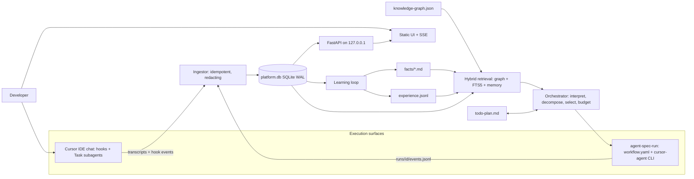
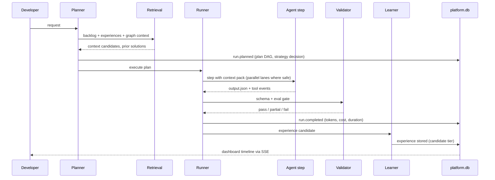
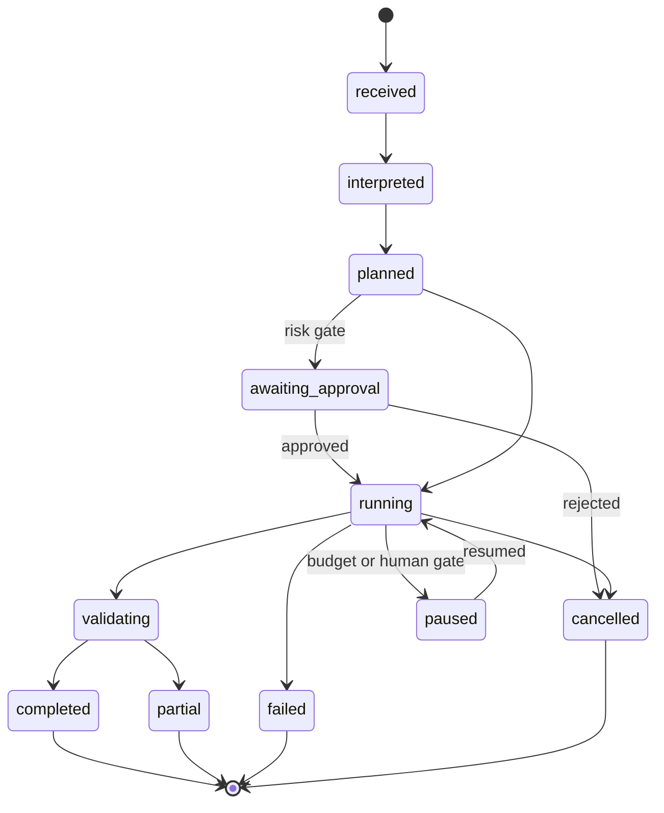
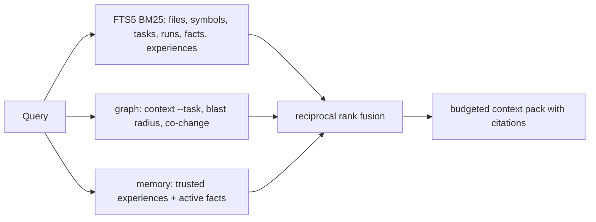
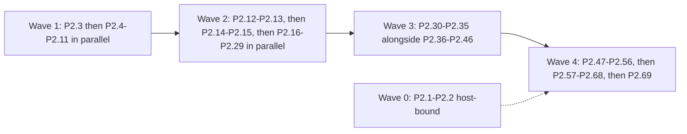

# Implementation Guide — Phase 2 (v2.0.0) and Phase 3 (v3.0.0)

> Unified HLD + LLD + implementation plan for every **pending** task in [`todo-plan.md`](../todo-plan.md).
> Strategy and phases: [`MASTER-PLAN.md`](MASTER-PLAN.md). This guide adds **no phases and no roadmap**.
> Phase 2 is designed to LLD depth; Phase 3 to contract depth.

## How to use this guide

| You are… | Read |
|----------|------|
| An engineering agent implementing one task | `grep -n '| P2.17 |' docs/IMPLEMENTATION-GUIDE.md` for your row in [§14](#14-ordered-todo-list-p-numbers), then ranged-read only the `§` sections it cites (this file is > 20 KB; never read it whole) |
| A reviewer approving the design | [§2](#2-system-architecture-hld), [§12](#12-decision-log), [§15](#15-open-questions-and-risks) |
| Building the dashboard | [§4.4](#44-sqlite-schema-d-001), [§4.5](#45-local-api-d-020), [§6](#6-dashboard-and-observability) |

**P-numbers.** `P2.n` / `P3.n` = phase + position in dependency-resolved execution order. They are
**labels on existing backlog IDs**, not new tasks. `P3.5` (sequence) is not `P3-005` (backlog ID) —
the row shows both. Status is tracked **only** in `todo-plan.md`.

**Confidence tags** follow the always-on rule: `HIGH` verified in code on 2026-10-29, `MEDIUM`
pattern-based, `LOW` needs a spike before building on it.

### Contents

1. [Baseline — what exists today](#1-baseline--what-exists-today)
2. [System architecture (HLD)](#2-system-architecture-hld)
3. [Orchestration and execution lifecycle (LLD)](#3-orchestration-and-execution-lifecycle-lld)
4. [Contracts](#4-contracts)
5. [Isolation, concurrency, idempotency, recovery](#5-isolation-concurrency-idempotency-recovery)
6. [Dashboard and observability](#6-dashboard-and-observability)
7. [Memory and self-learning](#7-memory-and-self-learning)
8. [Indexing, Graphify and hybrid retrieval](#8-indexing-graphify-and-hybrid-retrieval)
9. [Token, cost and performance strategy](#9-token-cost-and-performance-strategy)
10. [Security and privacy](#10-security-and-privacy)
11. [Testing and validation strategy](#11-testing-and-validation-strategy)
12. [Decision log](#12-decision-log)
13. [Backlog maintenance protocol](#13-backlog-maintenance-protocol)
14. [Ordered todo list (P-numbers)](#14-ordered-todo-list-p-numbers)
15. [Open questions and risks](#15-open-questions-and-risks)

---

## 1. Baseline — what exists today

Verified by reading code on 2026-10-29 `[CONFIDENCE: HIGH]`. Reuse these; do not rebuild them.

| Capability | Where | Reused by |
|------------|-------|-----------|
| File-level import graph v5.0 (nodes: `id,type,path,lang,layer,service,endpoints,produces,consumes`; edges: `imports`, `imports_ambiguous`, `http`, `message`) | `bin/graphify-build.py` (writes `.agent-spec/graph/knowledge-graph.json`) | D-006, D-007, D-008, D-025, O-005 |
| Incremental parse cache keyed by mtime+size and `PARSER_VERSION` | `bin/graphify-build.py` `load_cache`/`save_cache` (L615–650) | D-007 symbol extraction |
| Graph queries: `query --file`, `search`, `stats`, `cycles`, `module`, `flow`, `services`, `endpoints`, `layers`, `context --task --budget` | `bin/graphify-cli.py` | D-024, D-025, O-005, B-002 |
| Transcript locator + token analytics (`session`, `tools`, `compare`, `corpus`, `overhead`, `audit`) — Cursor has no usage data, so tokens = chars÷4 | `bin/agent-spec-tokens.py` | D-002, D-010, D-011, D-013 |
| Session receipt (`schema:1`, tokens, tool_calls, graph_queries, whole_file_reads, gates, facts_injected) | `bin/agent-spec-receipt.py` → `.agent-spec/metrics/receipts/<session>.json`, `metrics/daily.jsonl` | D-002, D-012, L-001 |
| ROI viewer, stdlib `http.server` on `127.0.0.1:8765` | `bin/agent-spec-roi.py serve` | Fallback UI when the platform extra is absent |
| Memory facts (frontmatter `id,type,subject,created,source`; 40-fact cap; team merge) | `bin/agent-spec-memory.py` | D-005, L-002, L-005 |
| SDLC gate state (`feature,gate,gate_name,artifacts,history,updated`) | `bin/agent-spec-gate.py` → `.agent-spec/sdlc/STATE.json` | D-004 |
| Hooks: `sessionStart` (digest), `preToolUse` (read discipline, returns `permission: deny`), `sessionEnd` + `stop` (receipt) — all fail-open | `hooks/cursor-*.py`, `.cursor/hooks.json` | S-002, D-002 |
| Doctor, selftest [1]–[12], doc-ref linter | `bin/agent-spec-doctor.py`, `bin/agent-spec-selftest.sh`, `bin/agent-spec-lint-refs.py` | Every task's verification |
| Subagents `agent-spec-search`, `agent-spec-verify`; 33 skills; 11 personas | `agents/`, `skills/`, `personas/` | O-009, O-016 |

**Absent** (verified by grep): SQLite, FastAPI, Pydantic, `workflow.yaml` runner, `experience.jsonl`,
registry code, symbol/call/co-change edges, embeddings, `.env` blocking in `preToolUse`.

**Design sources this guide reuses (cite, do not copy):**
[ADR-001](platform-design/adr/ADR-001-cursor-cli-orchestrator.md) L34–56 ·
[HLD-AGENT-HUB](platform-design/HLD-AGENT-HUB.md) §3 workflow schema L119–221, runner L235–286, contracts L494–532 ·
[ADAPTIVE-LEARNING](platform-design/reference/ADAPTIVE-LEARNING.md) L75–123 ·
[MULTI-REPO-INDEX](platform-design/reference/MULTI-REPO-INDEX.md) L63–155 ·
[DASHBOARD.md](DASHBOARD.md) L24–59 (feature → panel map).

---

## 2. System architecture (HLD)

### 2.1 Context



### 2.2 Components and responsibilities

| Component | Responsibility | New code | Backlog |
|-----------|----------------|----------|---------|
| **Ingestor** | Turn transcripts, hook output, gate state, facts, graph stats, run events into `platform.db` rows; redact; never store private reasoning | `bin/platform/ingest.py` | D-002…D-006, D-004.1, O-010 |
| **Store** | SQLite WAL, schema migrations, FTS5 | `bin/platform/schema.sql`, `bin/platform/db.py` | D-001, D-008 |
| **Local API** | Read endpoints, SSE event stream, guarded control endpoints | `bin/platform/api.py` | D-020, D-020.1, D-029 |
| **UI** | Static HTML + ES modules, vendored assets, no build step | `bin/platform/ui/` | D-010…D-028, L-004 |
| **Runner** | Deterministic DAG executor for `workflow.yaml`: state, checkpoints, retries, budgets, events | `bin/hub/runner.py`, `bin/agent-spec-run.py` | O-001…O-004, O-017…O-019, O-002.1 |
| **Planner** | Intent routing, decomposition, strategy, model and skill selection, context packs | `bin/hub/planner.py`, `bin/hub/policy.py` | O-005, O-005.1, O-006, O-007, O-016 |
| **AI runtime adapter** | One interface; `cursor_cli` now, SDK/Bedrock later | `bin/hub/runtime.py` | O-004, P3-010 |
| **Contracts** | Pydantic models for envelope, events, context pack, outputs | `bin/hub/contracts.py` | O-011 |
| **Learner** | Experience capture, distillation, validation, promotion, skill proposals | `bin/agent-spec-learn.py` | L-001…L-006, O-008 |
| **Graph enrichment** | Symbols, calls, co-change edges inside the existing graph build | `bin/graphify-build.py` (extend) | D-007 |
| **Backlog CLI** | Parse/update `todo-plan.md` with evidence-gated status changes | `bin/agent-spec-backlog.py` | D-004.1 |
| **Quarantine** | Block secret paths in `preToolUse` | `hooks/cursor-pre-tool-use.py` (extend) | S-002 |

**Packaging (DEC-03).** Everything under `bin/platform/` and `bin/hub/` is the **platform extra**:
`requirements-platform.txt` = `fastapi`, `uvicorn`, `pydantic>=2`, `pyyaml`. Core harness files stay
stdlib-only and must import nothing from the extra. Entry points detect a missing extra and print one
install line, exit 0 from hooks (fail-open) and exit 2 from CLIs.

### 2.3 End-to-end flow (success criterion)



Every arrow is an event row (§4.2) with one `trace_id`, so the dashboard reconstructs
Request → Planning → Decomposition → Selection → Execution → Validation → Results → Learning.

---

## 3. Orchestration and execution lifecycle (LLD)

> **Superseded in part by DEC-12 / DEC-13 (2026-10-31).** There is no Python runner, `AiRuntime`, thread pool, planner or policy module. Steps run as Task subagents driven by `skills/agent-spec-hub-runner/SKILL.md`; `bin/agent-spec-run.py` only records state. Read the algorithm below as the *behaviour the skill must produce*, not as code to write. Build list: §14.

### 3.1 Run state machine



Step states: `pending → ready → running → succeeded | failed | skipped | retrying | cancelled`.
Every transition emits exactly one event; state is derivable from events alone (replay = recovery).

### 3.2 Planner pipeline (O-005, O-005.1)

1. **Interpret.** Normalize the request into `{goal, task_ids[], files_hint[], risk}`. Look up
   matching backlog rows through `agent-spec-backlog.py find "<text>"` so existing tasks are reused, not
   recreated.
2. **Recall before solving.** Query validated experiences (L-003) by failure signature and keywords,
   then `graphify-cli.py context --task`. When a `trusted` experience matches with score ≥ threshold, the
   plan starts from its recorded steps (nearest reference → delta).
3. **Decompose** only when the work has more than one independently verifiable unit. Units become DAG
   steps with explicit `needs:`.
4. **Choose a strategy** — a deterministic function, logged as a `decision` event with its inputs:

| Strategy | When | Why |
|----------|------|-----|
| `direct` | One step, `risk=low`, context pack ≤ step budget | No orchestration overhead for simple work |
| `sequential` | Data dependency, or write sets overlap | Overlapping writes cause merge conflicts |
| `parallel` | Write sets disjoint, where write set = target files ∪ graph dependents at depth 1 | Cuts wall time without conflicts |

   Parallel width = `min(ready_steps, max_parallel)`, with `max_parallel` default 3. Steps that only
   read never conflict.
5. **Select** per step:
   - **Model tier** from `platform.yaml` `models: {fast, standard, deep}`. Rule: `fast` for lookup,
     summarize and format; `standard` for implement and review; `deep` for RCA, design, or any step on
     its second retry. Names are config, never hard-coded.
   - **Skill** (O-016): the step's `skill:` field, else a registry capability match.
   - **Agent** (O-009): a registry entry with matching `capabilities`.
6. **Context pack** per step (§4.3): only the files, symbols, facts and experiences that step needs,
   within its budget. Never the parent conversation.

### 3.3 Runner algorithm (O-002…O-004, O-007, O-017, O-018)

```text
load workflow (O-001 validate, O-019 pin version+sha) → create run dir (O-002) → write run.json
loop until no step is ready:
    ready = steps whose needs all succeeded and that are not done in checkpoint.json
    for batch in policy.batches(ready):              # parallel lanes ≤ max_parallel
        for step in batch (thread pool):
            if idempotency_key(step) already succeeded → emit step.skipped(reused) and continue
            emit step.started
            result = execute(step)                   # run: | ai: | mcp: | fetch:
            validate result against step.output schema (O-011)
            on failure: retry with backoff and model escalation (O-018), else mark failed
            persist output.json, then atomic checkpoint update (O-002.1)
    if run budget exceeded → emit budget.exceeded, set paused, stop
merge outputs (O-007) → eval gate (O-013) → final status success|partial|failed (O-017)
write AgentResult, experience candidate (O-008), receipt; emit run.completed
```

Step types:

- **`run:`** — Python or shell, with exit code gating (O-003).
- **`ai: true`** — `AiRuntime.invoke(prompt_file, context_pack, model, timeout)` (O-004).
- **`mcp:`** / **`fetch:`** — inputs fetched, not pasted (O-014). Inside the IDE this is the agent's MCP
  tools; headless it is a runtime adapter call.
- **`gate:`** — a human or risk gate (O-006) that pauses the run until `approve` or `reject` arrives.

### 3.4 ADR-001 alignment (DEC-02)

ADR-001 has `hub-runner.md` owning the loop and Python owning validation and storage. This guide keeps
that split and makes the loop's **state** deterministic:

- **Headless/CI surface:** `agent-spec-run.py` walks the DAG and invokes `cursor-agent` only for `ai:`
  steps. This is required for checkpoints, retries and budgets, which an LLM loop cannot guarantee.
- **IDE surface:** the chat agent follows `skills/agent-spec-hub-runner/SKILL.md`. It calls the same
  plumbing — `agent-spec-run.py step-start|step-end|checkpoint` — so IDE runs produce the same run
  directory and events.

This is an **amendment** to ADR-001 and needs reviewer sign-off; see [§15](#15-open-questions-and-risks) Q1.

### 3.5 Monitoring, validation, merge

- **Monitoring.** The runner emits a heartbeat every 15 s per running step. A missing heartbeat for
  3× `timeout_s` marks the step `failed(reason=stalled)`.
- **Validation.** Three layers: (1) Pydantic schema; (2) the step's declared `verify:` command (tests,
  lint) through `agent-spec-verify` semantics, so only the verdict plus failures are stored; (3) the eval
  gate for workflows with a golden set (O-013).
- **Merge** (O-007). The parent receives a list of `AgentResult`s. Citations are unioned by
  `(path,line)`. Conflicting conclusions produce `status=partial` with both kept, never a silent pick.
  File edits from parallel lanes merge only when the write sets were disjoint, which planning already
  guarantees.

### 3.6 Retry, timeout and budget policy (O-018, O-005.1)

| Knob | Default | Scope | On breach |
|------|---------|-------|-----------|
| `retries` | 2 | step | `retry` events; 2nd retry escalates model tier one level |
| `backoff` | 2 s × 2^n, jitter ±20% | step | — |
| `timeout_s` | 600 (`ai`), 120 (`run`) | step | kill process group → `failed(timeout)` |
| `max_tokens` | 60k (`ai`) | step | `budget.exceeded` → step failed, run `paused` |
| `max_cost_usd` | 5.00 | run | run `paused` awaiting approval |
| `max_parallel` | 3 | run | queued |

Non-retryable: schema errors in the workflow, policy denials, `cancelled`. Retryable: timeouts, non-zero
exit for steps marked `retry_on: [exit]`, runtime transport errors.

---

## 4. Contracts

### 4.1 Run directory (O-002)

```text
.agent-spec/runs/<run_id>/            # run_id = ULID (sortable, unique without coordination)
  run.json                            # envelope (4.3)
  events.jsonl                        # append-only, one event per line (4.2)
  checkpoint.json                     # {step_id: {status, output_sha, attempts}} — atomic replace
  steps/<step_id>/context.json        # context pack given to the step
  steps/<step_id>/output.json         # AgentResult or script output
  steps/<step_id>/log.txt             # capped at 64 KB, tail kept
  result.json                         # merged AgentResult
```

Retention: full run directories for 7 days, then compacted to `run.json` + `result.json` + summary
rows (matches D-003's "7d full, summary forever").

### 4.2 Event schema (one schema for both surfaces — DEC-01)

```json
{
  "schema": 1,
  "event_id": "01JB…",
  "ts": "2026-10-29T12:00:00.000Z",
  "run_id": "01JB…",
  "trace_id": "01JB…",
  "span_id": "s-…",
  "parent_span_id": "s-…",
  "source": "headless | ide",
  "type": "run.received | run.planned | run.status | step.started | step.finished | tool.called | tool.result | decision | retry | budget.exceeded | gate.requested | gate.resolved | memory.retrieved | experience.written | error | heartbeat",
  "actor": {"role": "rca-investigator", "agent": "agent-spec-search", "model": "standard", "skill": "agent-spec-investigate"},
  "step_id": "triage",
  "payload": {},
  "tokens": {"input": 0, "output": 0, "cache_read": 0, "estimated": true},
  "cost_usd": 0.0,
  "duration_ms": 0
}
```

Rules: `payload` is redacted before it is written (§10). `decision` payloads hold
`{choice, alternatives, inputs, reason}` — evidence, not chain-of-thought. IDE events are synthesized
by the ingestor with `event_id = sha1(transcript_path + ":" + line_no)`, so re-ingesting is a no-op.

### 4.3 Envelope, context pack, result (O-011)

> **Dropped (DEC-12).** No Pydantic contracts. Step output shapes live in the workflow skill prompts; the run directory (§4.1) and event schema (§4.2) stay.

Pydantic models live in `bin/hub/contracts.py`. They merge HLD-AGENT-HUB L494–532 with
AGENT-HUB-PLAN §11 (`files_read`). The nested RCA output stays as a workflow-specific `output` model.

```python
class RunEnvelope(BaseModel):
    run_id: str; trace_id: str; workflow_id: str; workflow_version: str; workflow_sha: str
    request: str; interpreted: dict; task_ids: list[str] = []
    strategy: Literal["direct", "sequential", "parallel"]; status: RunStatus
    budgets: Budgets; started: datetime; finished: datetime | None = None

class ContextPack(BaseModel):
    step_id: str; goal: str; budget_tokens: int
    files: list[FileRef]          # path, sha, ranges, reason
    symbols: list[SymbolRef]      # from D-007
    facts: list[FactRef]          # id, confidence
    experiences: list[ExpRef]     # id, tier, score
    upstream: dict[str, dict]     # outputs of steps in `needs`, summarized

class AgentResult(BaseModel):
    status: Literal["success", "partial", "failed"]; summary: str
    citations: list[Citation]; files_read: list[str]; files_changed: list[str]
    output: dict; experience_candidates: list[ExperienceCandidate]
    confidence: Literal["HIGH", "MEDIUM", "LOW", "UNKNOWN"]
    tokens: Tokens; cost_usd: float; duration_ms: int
```

### 4.4 SQLite schema (D-001)

File `bin/platform/schema.sql`. Database at `.agent-spec/platform/platform.db`, overridable by
`AGENT_SPEC_DB`, gitignored. `PRAGMA journal_mode=WAL`; migrations via `PRAGMA user_version`.

| Table | Key columns | Source |
|-------|-------------|--------|
| `requests` | `request_id` PK, `run_id`, `session_id`, `parent_request_id`, `source`, `prompt_redacted`, `interpreted_json`, `status`, `started`, `finished`, `tokens_*`, `cost_usd` | D-002, D-003, O-010 |
| `steps` | `step_id` PK, `request_id` FK, `ordinal`, `kind` (tool/skill/subagent/gate/ai/run), `name`, `status`, `started`, `duration_ms`, `tokens_*`, `bytes_in`, `whole_file` | D-002 |
| `subagent_runs` | `id` PK, `parent_request_id`, `child_request_id`, `agent`, `model`, `status`, `latency_ms`, `error` | D-003, D-028 |
| `events` | `event_id` PK, `run_id`, `trace_id`, `span_id`, `parent_span_id`, `ts`, `type`, `actor_json`, `payload_json`, `tokens_*`, `cost_usd` | O-010, O-012 |
| `gate_events` | `id` PK, `feature`, `gate`, `gate_name`, `ts`, `artifact`, `session_id` | D-004 |
| `tasks` | `task_id` PK, `slice`, `p_number`, `title`, `status`, `deps_json`, `evidence_json`, `updated` | D-004.1 |
| `memory_facts` | `fact_id` PK, `type`, `subject`, `bytes`, `confidence`, `status`, `expires`, `scope` (local/team) | D-005, L-005 |
| `fact_injections` | `fact_id`, `request_id` | D-005, D-026 |
| `experiences` | `exp_id` PK, `signature`, `tier`, `confidence`, `uses`, `successes`, `created`, `expires`, `run_id` | L-001, L-003 |
| `graph_stats` | `snapshot_id` PK, `ts`, `files`, `edges`, `symbols`, `cycles`, `sha`, `age_s` | D-006 |
| `ingest_offsets` | `source_path` PK, `byte_offset`, `prefix_sha`, `ingested_at` | D-002 idempotency |
| `fts_docs` | FTS5 virtual table (`kind`, `ref`, `title`, `body`) | D-008 |

### 4.5 Local API (D-020, D-020.1, D-029)

> **v1 shipped (DEC-13).** Stdlib `http.server` on 127.0.0.1, read-only JSON, one static page, polling every 5 s — see `bin/aspec_platform/serve.py` today.
> **v2 (DEC-14).** Same stdlib server; adds SPA bundle from `ui/dist/`, guarded POST routes, SSE streams, and thin `cursor-agent` launch for the Agent Console. Build list: `todo-plan.md` Slice 6b (CP-*); route tables in [`dashboard_overhaul.md`](../dashboard_overhaul.md) §6. The FastAPI table below remains the long-range upper bound, not the DEC-14 build target.

FastAPI, `127.0.0.1` only, default port 8765. `agent-spec-platform.py serve` starts the dashboard when
the extra is installed and otherwise execs `agent-spec-roi.py serve` on the same port, so only one
server ever binds 8765.

| Method | Path | Returns |
|--------|------|---------|
| GET | `/api/health` | db version, ingest lag, graph age, extra version |
| POST | `/api/ingest` | trigger incremental ingest (token-guarded) |
| GET | `/api/runs?status=&source=&since=` | paginated run list |
| GET | `/api/runs/{id}` | envelope, plan DAG, steps, totals |
| GET | `/api/runs/{id}/events` | **SSE** stream; `Last-Event-ID` resume |
| GET | `/api/runs/{id}/steps/{step}` | context pack refs, output, tool calls, retries |
| POST | `/api/runs/{id}/retry` · `/cancel` · `/approve` · `/reject` | headless runs only; 409 for IDE runs |
| GET | `/api/tasks` · `/api/tasks/{id}` | backlog rows, deps, linked runs and evidence |
| GET | `/api/metrics?days=7` | KPIs, waterfall, trends |
| GET | `/api/graph/file?path=` · `/api/graph/context?task=` | dependents, blast list, context pack + token sum |
| GET | `/api/memory/facts?q=` · `/api/memory/experiences?q=` | with "reused by" runs |
| POST | `/api/ask` | hybrid answer + `path:line` citations + token meter |
| POST | `/api/simulate` | naive vs graph vs RAG token comparison |
| GET | `/api/export?format=csv\|json` | proof pack (D-014) |

Controls are implemented by writing a `control.json` command file into the run directory. The runner
polls it between steps, which keeps the API stateless and the runner the single writer of run state.

### 4.6 Workflow schema delta (O-001)

> **Re-scoped (DEC-12).** A workflow is `skills/agent-spec-wf-<name>/SKILL.md` with a ```` ```steps ```` block, validated by `agent-spec-run.py validate`. There is no `workflow.yaml`, no PyYAML and no `run:`/`mcp:` step types: deterministic steps are `ai: false`, MCP fetches are named in an AI step prompt.

Base: HLD-AGENT-HUB §3 (`id`, `input`, `repo_profiles`, `experience`, `steps[]` with `run:` / `mcp:` /
`ai: true`, `output`, `experience_write`). Added fields:

```yaml
version: 1.2.0
budgets: {max_cost_usd: 5, max_parallel: 3}
steps:
  - id: triage
    ai: true
    model: standard          # tier, resolved via platform.yaml
    skill: agent-spec-investigate
    needs: [fetch_ticket]
    writes: []               # declared write set; empty = read-only, always parallel-safe
    verify: "python3 -m pytest -q tests/rca"   # optional
    retries: 2
    timeout_s: 600
    retry_on: [timeout, exit]
    output: schemas/triage.json
  - id: approve_post
    gate: human
    when: "steps.triage.output.confidence != 'HIGH'"
```

The legacy template `platform-design/templates/agent/workflow.yaml` (`pipeline` / `sub_agents`) is
superseded; O-001 rejects it with a migration message.

---

## 5. Isolation, concurrency, idempotency, recovery

| Concern | Mechanism | Why |
|---------|-----------|-----|
| Session isolation | Each headless run is a separate `cursor-agent` process with its own context pack; IDE subagents use Cursor Task (separate context) | No cross-talk between steps; minimal context per agent |
| Parallel writers | `git worktree` per writing lane when the workspace is a git repo; otherwise lanes with non-empty `writes` are serialized | No repository exists today (T-056 deferred); serializing is the safe fallback |
| DB concurrency | WAL; the **ingestor is the only writer**; API reads; runner writes files, not DB | Removes write contention and lock bugs |
| Run-dir concurrency | `flock` on `runs/<id>/.lock` (same pattern as `graphify-build.py`, A-003); atomic `os.replace` for checkpoint and outputs | Proven in-repo pattern |
| Ingest idempotency | `ingest_offsets` (byte offset + sha of the prefix; a rewritten file triggers re-ingest from 0); `event_id` PK with `INSERT OR IGNORE` | Re-running ingest never duplicates rows |
| Step idempotency | `key = sha256(workflow_sha, step_id, canonical inputs, upstream output shas)`; a prior success with the same key is reused | Resume and retry never redo finished work |
| Crash recovery | `agent-spec-run.py resume <run_id>` replays `events.jsonl` + `checkpoint.json`; `running` steps without `step.finished` are re-run (they are idempotent by key) | Interrupted work resumes without loss |
| Derived-store recovery | `agent-spec-platform.py ingest --rebuild` recreates `platform.db` from files | Files are the source of truth (DEC-04) |
| Failure isolation | One step failing marks only its dependents `skipped`; independent lanes continue → `partial` | Maximizes useful output |

---

## 6. Dashboard and observability

### 6.1 Principles

Local-first. The UI reflects **events**, not guesses. Read-only for IDE sessions (they cannot be driven
externally); controls only for headless runs. No CDN: vendored assets under `bin/platform/ui/vendor/`
(DEC-03). Responsive grid down to 1024 px; dark and light themes through CSS variables.

### 6.2 Information architecture

| Page | Shows | Backlog |
|------|-------|---------|
| **Home** | Runs and tokens today, 7-day saved vs baseline, index freshness chip, doctor line, running runs | D-012, D-006 |
| **Runs** | Filterable list: status, source (ide/headless), workflow, tokens, cost, duration | D-021 |
| **Run detail** | (a) Request card: original prompt (redacted), interpreted goal, linked task IDs. (b) Plan DAG: nodes coloured by state, parallel lanes. (c) Timeline: sessionStart → skills → subagents → tools → gates, swimlane per agent. (d) Token waterfall per step. (e) Step drawer: role, model, skill, context-pack refs, output, tool calls and results, retries, errors, decisions with evidence, retrieved memory. (f) Controls: retry step, cancel, approve/reject gate | D-021, D-029, O-017, O-018 |
| **Tasks** | Backlog by slice with P-numbers, status, blockers, dependency graph, linked runs and evidence | D-004.1 |
| **Subagent health** | Per-agent success rate, p50/p95 latency, last errors, jump to failed step | D-028 |
| **Gaps** | Whole-file read without graph query, test failure, token spike (> 2σ over the 7-day median), missing gate, S-002 blocks | D-022 |
| **Cost** | Largest Read payloads, per-tool cost, session compare | D-013, D-011 |
| **Graph** | Pick a file → dependents, blast list, context pack, token sum | D-025 |
| **Memory** | Facts and experiences, tier, confidence, expiry, "injected into / reused by" runs | D-026, L-005 |
| **Learning** | Corrections per task, tokens per task, repeat-failure rate, reuse hit rate | L-004 |
| **Playground / Savings** | Naive vs graph vs RAG; editable price weights | D-023, D-010 |
| **Ask** | Hybrid Q&A with `path:line` citations and a token meter | D-024 |
| **Settings** | Workspace manifest (multi-root), DB path, price table | D-027 |

### 6.3 Live updates

The ingestor tails `runs/*/events.jsonl` (1 s poll) and the transcript directory (5 s poll; IDE events
lag by design). The API streams `events` rows over SSE per run, plus a global `/api/events` channel
for Home. Clients reconnect with `Last-Event-ID`.

### 6.4 Observability

Local trace and span ids are always written (O-012). Langfuse is an optional exporter that reads
`events` and posts spans when `LANGFUSE_HOST` is set (DEC-07; stack in P3-016). Metrics are computed
from `events` and `requests`, never from a second counter.

---

## 7. Memory and self-learning

### 7.1 Memory layers (one store per layer, no new stores)

| Layer | Store | Lifetime | Written by |
|-------|-------|----------|------------|
| Short-term | `steps/<id>/context.json` | the run | Planner |
| Episodic | `.agent-spec/memory/experience.jsonl` (mirrored to `experiences`) | TTL, default 90 days | Learner (L-001, O-008) |
| Semantic | `.agent-spec/memory/facts/*.md` | until superseded or expired | `/agent-spec-remember`, L-002 |
| Procedural | `skills/`, workflows, `skill-proposals/` | versioned | Humans; L-006 proposes |
| Codebase | `knowledge-graph.json` + FTS | rebuilt incrementally | Graphify (D-007) |

### 7.2 Loop

**Observe** (events) → **Capture** (L-001: one experience record per finished run) → **Analyze**
(signature = sha1 of normalized error class + sorted touched files + workflow id) → **Validate**
(rules below) → **Store** → **Retrieve** (L-003, before planning) → **Reuse** (plan seeded from the
experience) → **Improve** (L-006 proposes a skill after ≥ 3 successful reuses of the same procedure).

### 7.3 Experience record (L-001)

Extends ADAPTIVE-LEARNING L75–94:

```json
{"schema": 1, "exp_id": "…", "signature": "…", "workflow": "rca", "task_ids": ["B-007"],
 "problem": "…", "root_cause": "…", "fix": "…", "steps": ["…"], "files": [{"path": "…", "sha": "…"}],
 "outcome": "success|partial|failed", "tokens": 0, "retries": 0, "corrections": 0,
 "facts_injected": ["…"], "tier": "candidate", "confidence": "MEDIUM",
 "provenance": {"run_id": "…", "author": "agent|human", "approved_by": null},
 "version": 1, "supersedes": null, "created": "…", "expires": "…"}
```

### 7.4 Validation, promotion, rollback (DEC-06)

- **Tiers:** `candidate → trusted → deprecated`. The registry tier `verified` maps to `trusted`.
- **candidate → trusted** requires either ≥ 2 successful reuses with no correction, or explicit human
  approval in the Memory page. This writes `approved_by`.
- **Retrieval priority:** `trusted` first. `candidate` items are shown, labelled, and never auto-applied
  for writes.
- **Staleness:** when the sha of a referenced file changes, the record is flagged `stale` and drops one
  confidence level until it is revalidated.
- **Expiry:** expired records are excluded from retrieval but kept for audit.
- **Rollback:** `agent-spec-learn.py deprecate <id>` (reversible); `supersedes` links keep the history.
- **Trusted skill updates:** L-006 writes `skill-proposals/<name>/SKILL.md` plus evidence. Publishing
  into `skills/` needs human approval (P3-012 hardens this into an approval trail).

### 7.5 Fact schema v2 (L-005)

Adds optional frontmatter: `confidence` (HIGH/MEDIUM/LOW), `expires`, `provenance`, `version`,
`supersedes`, `status` (active/stale/deprecated). Backward compatible: a missing field means MEDIUM,
no expiry, active. `agent-spec-memory.py lint` gains checks for expired and superseded facts; the
digest skips non-active facts.

### 7.6 Effectiveness metrics (L-004)

- Repeat-failure rate: the same signature failing again within 30 days.
- Reuse hit rate.
- Tokens per task and time per task, compared between runs with and without reuse.
- Human corrections per task.
- Retrieval precision: accepted ÷ shown. MASTER-PLAN target ≥ 80%.

---

## 8. Indexing, Graphify and hybrid retrieval

### 8.1 Graph enrichment (D-007), inside the existing build

- **Symbol nodes:** `type: symbol`, `kind` (class/function/method), `file`, `line`. Python uses `ast`;
  Java, TypeScript and Kotlin use the existing regex style. Extraction is cached per file with the same
  mtime+size cache (bump `PARSER_VERSION`).
- **`calls` edges:** name-resolved within imports; `confidence: low` when ambiguous (mirrors
  `imports_ambiguous`).
- **`co_changes` edges:** from `git log --name-only -n 500` with weight = co-commit count ≥ 3; skipped
  without git.
- **`graphify-cli.py`** gains `symbols --file`, `callers --symbol`, `cochange --file`. `context --task`
  ranks co-change neighbours into the pack.
- **Size guard:** symbol nodes are capped per file (200), and `KNOWLEDGE-GRAPH.md` stays file-level.

### 8.2 Hybrid retrieval (D-008, D-024)

> **Dropped (DEC-13).** No FTS5 index, no rank fusion, no `/api/ask`. Retrieval is Cursor codebase search, the `agent-spec-search` subagent and the Graphify graph (symbols and callers only, D-007). Revisit in Phase 3 if the AUTO-3807 eval shows a recall gap.



Semantic embeddings are deferred behind `retrieval.embeddings: false` (DEC-05). FTS rows update from
the same changed-file list the graph build computes, so there is no second scan.

### 8.3 Knowledge relationships

`fts_docs` and the `tasks` / `experiences` / `requests` tables link **task ↔ run ↔ files ↔ experience
↔ fact** by ids. Task-to-code links come from `files_changed` in `AgentResult`. This is the only place
cross-entity relationships live; there is no separate knowledge graph store.

---

## 9. Token, cost and performance strategy

| Lever | Mechanism | Measured by |
|-------|-----------|-------------|
| Progressive loading | Context pack holds refs + ranges; the agent reads more only through graph or ranged reads | `bytes_in` per step |
| No repeated reads | Context pack carries file shas; a step skips reading a file whose sha matches an upstream output's `files_read` | `steps.whole_file`, D-022 |
| Reuse before research | L-003 retrieval runs before planning; a trusted hit seeds the plan | Reuse hit rate, Δ tokens |
| Compact inter-agent sharing | `upstream` carries summarized outputs (≤ 1 KB each), never transcripts | `context.json` size |
| Model routing | Tier table (§3.2); escalate only on retry | Cost per successful task |
| Parallelism | Disjoint write sets only; `max_parallel` 3 | Wall time vs sum of step time |
| Budgets | Per-step tokens, per-run cost (§3.6) | `budget.exceeded` events |
| Persisted artifacts | Outputs on disk, the conversation carries ids | Run-dir sizes |
| Stable prefix | Always-on files untouched mid-run | Cache-read share where usage exists |

**Cost accounting.** `cost_usd = Σ tokens × price[model]`, with prices in `platform.yaml`. Cursor IDE
transcripts carry no usage, so IDE costs are marked `estimated: true` (chars÷4, as
`agent-spec-tokens.py` does today). Headless usage depends on what `cursor-agent` reports
([§15](#15-open-questions-and-risks) Q2). The primary efficiency KPI is **cost per successfully
completed task** (HLD.md Appendix D).

---

## 10. Security and privacy

| Threat | Control | Task |
|--------|---------|------|
| Agent reads or writes secrets | `preToolUse` hard-denies `.env*`, `*.pem`, `*.key`, `id_rsa*`, `credentials*`, `secrets.*`, and paths under `~/.aws`, `~/.ssh`; logs a `quarantine` event. The deny-list match runs **first**, before any parsing that can raise, so ordinary hook errors still fail open without skipping it | S-002 |
| Secrets in stored data | Ingest redaction: key=value secrets, bearer tokens, AWS keys, private-key blocks, high-entropy strings ≥ 32 chars → `«redacted:kind»` | S-003 |
| Private reasoning exposure | Thinking blocks are dropped at ingest; `decision` events store choice + evidence only | D-002 |
| Malicious web page calling localhost | Bind `127.0.0.1`; reject a non-`localhost` / `127.0.0.1` `Host` header (DNS rebinding); per-launch random token required on POST (cookie + header, CSRF) | S-003 |
| Unintended actions | Control endpoints work only on headless runs; `approve` is required for `gate:` steps and for runs over budget | D-029, O-006 |
| Data exfiltration | No outbound calls by default; the Langfuse exporter is opt-in | O-012 |
| Tampering | `events.jsonl` is append-only; P3-011 export adds hash chaining | P3-011 |

---

## 11. Testing and validation strategy

- **Unit tests.** One `tests/test_<module>.py` per new module, in the existing stdlib `unittest` style,
  added to selftest [11]. Platform-extra tests skip cleanly when the extra is missing.
- **Fixtures.** `tests/fixtures/transcripts/*.jsonl` (synthetic, no real data),
  `tests/fixtures/workflows/*.yaml`, a tiny sample repo for graph tests.
- **Selftest.** New section [13] "platform": schema init, ingest idempotency (ingest twice → same row
  counts), API health, fixture workflow end-to-end (O-020), redaction corpus.
- **Contract tests.** Every Pydantic model round-trips its fixture JSON; the SQLite schema version
  matches the migration count.
- **Evaluation.** B-003 golden set (AUTO-3807) produces strict and directional % against the BugBot
  baseline; O-013 blocks promotion when it regresses.
- **Performance.** Ingest of 1,000 transcript lines < 2 s; `/api/runs` p95 < 100 ms on 10k events;
  graph build with D-007 ≤ 1.5× the current time on this repo.
- **Learning.** A two-run fixture where run N+1 retrieves run N's experience; the assertion is fewer
  steps or tokens (the MASTER-PLAN P2 exit criterion).
- **Done means:** acceptance criteria met, tests green with real output pasted into the task's evidence,
  `agent-spec-lint-refs.py` = 0 dangling, doctor green.

---

## 12. Decision log

| ID | Decision | Why | Alternatives rejected |
|----|----------|-----|-----------------------|
| DEC-01 | Two execution surfaces, one event schema | IDE chats cannot be driven externally but must be traceable; headless runs need control | Headless-only (loses daily IDE use); IDE-only (no CI, no control) |
| DEC-02 | Keep ADR-001; a deterministic Python runner owns state, `cursor-agent` runs `ai:` steps; the IDE skill uses the same plumbing | Checkpoints, retries and budgets need determinism; reasoning stays with the AI | Pure LLM loop (no durable state); Python orchestrator calling models directly (contradicts ADR-001) |
| DEC-03 | Core stays stdlib-only; platform is an optional extra (FastAPI, uvicorn, Pydantic, PyYAML); static UI, no build step, no CDN | Install friction stays zero for harness-only users; local-first | All stdlib (YAML + validation by hand); React build (toolchain burden) |
| DEC-04 | Files are the source of truth; SQLite is derived and rebuildable | Git-backed durability; corruption is recoverable | DB as primary (fragile, not reviewable) |
| DEC-05 | Retrieval = graph + FTS5 BM25 + memory with rank fusion; embeddings deferred | No model dependency, deterministic, offline | Vector DB now (infra, non-determinism) |
| DEC-06 | Tiers `candidate / trusted / deprecated`; registry `verified` → `trusted` | Resolves ADAPTIVE-LEARNING vs `agent-registry.yaml` | Two vocabularies |
| DEC-07 | Langfuse optional; local trace ids always | Zero infra by default | Langfuse required (AGENT-HUB-PLAN §9) |
| DEC-08 | 666 tools and Log Analyzer called as `run:` steps; no handoff contract | Deterministic, testable; follows the ratified rule in AGENT-HUB-PLAN L419 and L623 and retires the earlier `BugbotHandoffContract` mentions (L253, L269) | Handoff contract to BugBot / Log Analyzer |
| DEC-09 | Single DB writer (ingestor); runner writes files; API writes only `control.json` | Removes lock contention | Multi-writer SQLite |
| DEC-10 | Parallel writers need git worktrees; otherwise serialize | Workspace has no git today | Temp-dir copies (merge-back risk) |
| DEC-11 | Platform package is `bin/aspec_platform/`, not `bin/platform/` | A directory named `platform` shadows the stdlib module when `bin/` is on `sys.path` | `bin/platform/` as written in §14 |
| DEC-12 | **Cursor-native orchestration; minimum new code (2026-10-31).** Code only where determinism or a hook is required: DB + ingest, run-dir plumbing script, S-002 hook, backlog CLI, thin stdlib dashboard API. Everything else is skills + Cursor subagents (Task): AI steps run as Cursor Task subagents, parallel fan-out = parallel Task calls, human gates = chat approval, MCP fetch = Cursor MCP tools, retry/model/budget policy = skill text + `agents/*.md`. **Dropped:** Python hub-runner, `CursorCliRuntime`, Pydantic contracts, PyYAML `workflow.yaml`, FastAPI/uvicorn (API is stdlib `http.server` + SSE). Workflows are `skills/agent-spec-wf-*/SKILL.md`. Supersedes DEC-02 and the extra in DEC-03: the whole platform stays stdlib-only, so `requirements-platform.txt` is removed. | User direction: rely on the Cursor harness, add only necessary hooks; fewer moving parts; zero install friction | Headless Python runner (more code, CI-only benefit; revisit in Phase 3 if CI needs it) |
| DEC-13 | **Phase 2 re-baselined to DEC-12 (2026-10-31).** 26 rows merged, dropped or deferred (FTS5/RAG, SSE, run controls, Pydantic, registry, Langfuse, CI runner, 666 adapter code, 5 dashboard panels now served by existing CLIs/skills). Live work: 19 rows to build, 8 skill-written and owed a live run. Rule for new rows: if a skill plus an existing CLI can do it, it is a skill. | User direction: maximum AI agents and Cursor harness, minimum code, low maintenance | Building the full dashboard, API and orchestration stack as originally specified |
| DEC-14 | **Interactive control plane (2026-11-06, approved 2026-11-07).** Vite + React + TypeScript + Tailwind in package-root `ui-src/`, built to `bin/aspec_platform/ui/dist/`; `serve.py` SPA fallback + tightened CSP; guarded POST routes and SSE for Agent Console and workflows via thin `cursor-agent` subprocess (`agent_exec.py`). Reopens D-020.1 and D-029 under Slice 6b (CP-*); supersedes GET-only dashboard guard memory. Unchanged: stdlib-only Python in `bin/`, loopback bind, per-launch token, no `aspec_platform` import from core `bin/`. Full spec: [`dashboard_overhaul.md`](../dashboard_overhaul.md) §3. | User direction: complete control-plane v2 per overhaul plan | DEC-13 cuts to GET-only v1 UI and human-only run controls |

**Contradictions resolved here** (stale docs get a one-line pointer):
- Orchestrator shape → DEC-02.
- `workflow.yaml` schema → §4.6.
- `AgentResult` shape → §4.3.
- Promotion tiers → DEC-06.
- Run storage (DynamoDB vs SQLite) → SQLite in P2; DynamoDB stays a P3 hosting option.
- Langfuse → DEC-07.
- BugBot handoff → DEC-08.

---

## 13. Backlog maintenance protocol

- `todo-plan.md` stays the only status record. `agent-spec-backlog.py` (D-004.1) parses its tables;
  `set <ID> [x]` is refused unless `--evidence <path|run_id>` is given, and the evidence is appended to
  the row's notes.
- The orchestrator calls `backlog find` before planning (reuse existing tasks) and `backlog set` after
  validation (status `[~]` on start, `[x]` only after acceptance passes).
- New work found mid-run is proposed as a row in the **existing** slice, with the next free ID in that
  slice's prefix, or a `.n` suffix for a subtask. `O-021…O-054` are reserved by AGENT-HUB-PLAN.
- Resuming: `agent-spec-run.py resume` plus `[~]` rows give the open frontier;
  `.agent-spec/SESSION-SNAPSHOT.md` carries the narrative.

---

## 14. Ordered todo list (P-numbers)

> **Re-baselined 2026-10-31 (DEC-13).** Rows marked *(dropped)* are kept for traceability and are not built. Build text reflects DEC-12: skills first, code only for DB + ingest, run-dir plumbing, hooks, backlog CLI and the thin stdlib API.

Execution order is dependency-resolved. Slice membership and IDs are unchanged in `todo-plan.md`.
Slice 9 may run alongside Slices 5–8 because it is gated only on Slice 1, which is closed. That is why
O-core (P2.36–P2.46) precedes B-006 (P2.63). **New** = a row added to `todo-plan.md` for a verified gap.

Columns: **P#** · **ID** · **Depends on** · **Build** (files / interfaces) · **Test** · **Done when** · **§**

### P2 — Phase 2 (v2.0.0)

#### Wave 0 — Slice 4c carry-over (host-bound; does not block Wave 1)

| P# | ID | Depends | Build | Test | Done when | § |
|----|----|---------|-------|------|-----------|---|
| P2.1 | T-057 | — | Run PHASE1-VERIFICATION B18–B20 in live Cursor; adjust `RANGE_KEYS` in `hooks/cursor-pre-tool-use.py` from the real payload | `tests/test_pre_tool_use.py` with the captured payload fixture | Live payload recorded; ranged reads allowed; digest hook < Cursor timeout | 1 |
| P2.2 | T-058 | — | Run PHASE1-VERIFICATION B21 on Windows Git Bash/WSL | Run sheet E | B21 pass recorded; DEBT-006 closed or re-scoped | 1 |
| — | T-056 | git repo | Deferred (no repository) | — | Unchanged | 12 DEC-10 |

#### Wave 1 — Slice 5 data layer

| P# | ID | Depends | Build | Test | Done when | § |
|----|----|---------|-------|------|-----------|---|
| P2.3 | D-001 | — | `bin/platform/schema.sql`, `bin/platform/db.py` (`connect()`, `migrate()`), `bin/agent-spec-platform.py init`, `requirements-platform.txt`; create selftest section [13] "platform" (skips cleanly without the extra) and the R1 import guard | `tests/test_platform_db.py`, selftest [13] | All §4.4 tables; WAL; `user_version`; path via `AGENT_SPEC_DB`; [13] green | 4.4, 11 |
| P2.4 | D-002 | P2.3 | `bin/platform/ingest.py transcripts` reusing the `agent-spec-tokens.py` locator; one `request` per user prompt, ordered `steps`; drops thinking blocks | `tests/test_ingest_transcripts.py` (run twice → identical counts) | Fixture transcript → expected rows; idempotent | 4.2, 5, 10 |
| P2.5 | D-003 | P2.4 | Parent/child linkage in `subagent_runs`; 7-day retention compaction job | `tests/test_ingest_subagents.py` | Child rows link to parent; compaction keeps summaries | 4.1, 15 Q3 |
| P2.6 | D-004 | P2.3 | Ingest `STATE.json` history → `gate_events` | `tests/test_ingest_gates.py` | Gate timeline rows per transition | 4.4 |
| P2.7 | D-004.1 **New** | P2.3 | `bin/agent-spec-backlog.py` (`list`, `find`, `show`, `set --evidence`); ingest → `tasks` | `tests/test_backlog.py` (parse current `todo-plan.md`; refuse `[x]` without evidence) | All rows parsed, P-numbers attached; evidence gate enforced | 13 |
| P2.8 | D-005 | P2.3 | Mirror facts → `memory_facts`; receipt `facts_injected` → `fact_injections` | `tests/test_ingest_memory.py` | Byte cost per session visible | 7.1 |
| P2.9 | D-006 | P2.3 | `graphify-build.py` writes a stats snapshot; ingest → `graph_stats` | `tests/test_ingest_graph.py` | files/edges/cycles/sha/age persisted after each build | 8.1 |
| P2.10 | D-007 **New** | P2.9 | Symbol nodes + `calls` edges in `graphify-build.py`; `graphify-cli.py` gets `symbols`, `callers` | `tests/test_graph_symbols.py` on the fixture repo | Symbols extracted for py/java/ts; build <= 1.5x baseline time | 8.1 |
| P2.11 | D-008 *(dropped)* | P2.3, P2.10 | Dropped (DEC-13): Cursor codebase search + `agent-spec-search` subagent + graph replace FTS5/RAG | - | - | 8.2 |

#### Wave 2 — Security first, then Slice 6 UI

| P# | ID | Depends | Build | Test | Done when | § |
|----|----|---------|-------|------|-----------|---|
| P2.12 | S-002 | — | Deny list in `hooks/cursor-pre-tool-use.py`; `quarantine` line to `metrics/quarantine.jsonl` | `tests/test_pre_tool_use.py` cases for every pattern | Secret paths denied for Read/Write/Shell; ingested into D-022 | 10 |
| P2.13 | S-003 **New** | P2.3 | Host check + launch token in the stdlib server; `bin/aspec_platform/redact.py` already built | `tests/test_redact.py`, `tests/test_api_security.py` | Corpus redacted; bad Host or missing token rejected | 10 |
| P2.14 | D-020 | P2.4–P2.9, P2.13 | **Built 2026-10-31** as `bin/aspec_platform/serve.py` (+ `ui/index.html`; shares guards with S-003; endpoints `health`, `runs`, `runs/{id}`, `tasks`; D-012/D-021/D-022/D-010 add routes to `ROUTES`): stdlib `http.server` on 127.0.0.1, read-only JSON from SQLite, serves one static `ui/index.html`; `agent-spec-platform.py serve` | `tests/test_api.py` (urllib) | GET endpoints return fixture data; no third-party import | 4.5, 10 |
| P2.15 | D-020.1 | P2.14 | Reopened (DEC-14): SSE for Agent Console stream and live run steps; see CP-012, CP-013, CP-021 | `tests/test_api_security.py` POST/SSE guards | Slice 6b CP rows green | 6.3 |
| P2.16 | D-012 | P2.14 | Home section of `ui/index.html`: KPIs + learning trend (absorbs L-004) | UI smoke + `/api/metrics` check | KPIs match `/api/metrics` | 6.2 |
| P2.17 | D-021 | P2.14 | Runs list + detail incl. tools and subagent tabs (absorbs D-013, D-028) | UI smoke on a fixture run | Fixture run renders timeline, waterfall, tools, subagents | 6.2 |
| P2.18 | D-013 *(dropped)* | P2.17 | Dropped (DEC-13): merged into D-021 (tools tab) | - | - | 6.2 |
| P2.19 | D-022 | P2.17, P2.12 | SQL rules in `bin/aspec_platform/gaps.py` + panel | `tests/test_gaps.py` | Each of the 5 flags fires on its fixture | 6.2 |
| P2.20 | D-028 *(dropped)* | P2.5, P2.17 | Dropped (DEC-13): merged into D-021 (subagents tab) | - | - | 6.2 |
| P2.21 | D-011 *(dropped)* | P2.14 | Dropped (DEC-13): merged into D-010 | - | - | 6.2 |
| P2.22 | D-010 | P2.14 | Savings + session-compare page (naive vs graph; two transcripts -> `agent-spec-tokens.py compare`) | `tests/test_savings.py` | Delta tokens and $ match a hand-computed fixture | 9 |
| P2.23 | D-023 *(dropped)* | P2.22, P2.11 | Dropped (DEC-13): merged into D-010 | - | - | 6.2 |
| P2.24 | D-025 *(dropped)* | P2.10, P2.14 | Dropped (DEC-13): covered by `agent-spec-blast-radius` + `agent-spec-query-graph` | - | - | 8 |
| P2.25 | D-024 *(dropped)* | P2.11 | Dropped (DEC-13): covered by `agent-spec-query-graph` + `agent-spec-search` subagent | - | - | 8.2 |
| P2.26 | D-026 *(dropped)* | P2.8 | Dropped (DEC-13): covered by `agent-spec-memory.py` | - | - | 7 |
| P2.27 | D-027 *(dropped)* | P2.14 | Dropped (DEC-13): deferred to Phase 3 mesh | - | - | 6.2 |
| P2.28 | D-014 | P2.14 | `agent-spec-platform.py export` CSV/JSON | `tests/test_export.py` | Export has metrics only, no source or prompts | 4.5 |
| P2.29 | S-001 | — | `bin/agent-spec-blast-radius` over `graphify-cli` | `tests/test_blast_radius.py` | Coloured output; `--no-color` for CI | 8 |

#### Wave 3 — Slice 7 learning, Slice 9 orchestration core

| P# | ID | Depends | Build | Test | Done when | § |
|----|----|---------|-------|------|-----------|---|
| P2.30 | L-005 **New** | — | Fact frontmatter v2 in `agent-spec-memory.py`; lint for expired / superseded; digest skips non-active facts | `tests/test_memory.py` additions | Old facts still valid; expired facts excluded from digest | 7.5 |
| P2.31 | L-001 | P2.3 | `agent-spec-receipt.py` appends `.agent-spec/experience.jsonl` (7.3); hub-runner `finish` adds workflow runs (absorbs O-008) | `tests/test_receipt.py` additions | One schema-valid record per finished session or run | 7.3 |
| P2.32 | L-002 | P2.30, P2.31 | `skills/agent-spec-learn/SKILL.md`: distill, recall, propose; facts written via `agent-spec-memory.py`; no Python (absorbs L-003, L-006) | `agent-spec-lint-refs.py` + one live run recorded | Correction -> fact with provenance; recall returns <= 3 matches; proposals never write into `skills/` | 7.2 |
| P2.33 | L-003 *(dropped)* | P2.31, P2.11 | Dropped (DEC-13): merged into L-002 (recall mode) | - | - | 7.2, 9 |
| P2.34 | L-004 *(dropped)* | P2.31, P2.17 | Dropped (DEC-13): merged into D-012 | - | - | 7.6 |
| P2.35 | L-006 *(dropped)* | P2.31 | Dropped (DEC-13): merged into L-002 (propose mode) | - | - | 7.4 |
| P2.36 | O-011 *(dropped)* | — | Dropped (DEC-13): Pydantic contracts removed by DEC-12 | - | - | 4.3 |
| P2.37 | O-001 | - | `agent-spec-run.py validate` parses the `steps` block of `skills/agent-spec-wf-*/SKILL.md` (built) | `tests/test_workflow_validate.py` | Valid skill accepted; legacy template rejected with a message | 4.6 |
| P2.38 | O-002 | - | `agent-spec-run.py`: run dir, `run.json`, `events.jsonl`, step-start / step-end / checkpoint plumbing (built) | `tests/test_run_dir.py` | Run-dir layout created atomically | 4.1, 3.4 |
| P2.39 | O-002.1 **New** | P2.38 | `checkpoint.json`, idempotency keys, `agent-spec-run.py resume` | `tests/test_resume.py` (kill mid-run, resume) | Finished steps not re-run; final state identical | 5 |
| P2.40 | O-003 | P2.38 | hub-runner skill: `ai: false` steps run a shell command; non-zero exit fails the step | Live run of `agent-spec-wf-example` with one deterministic step | Failed command -> failed step, output recorded | 3.3 |
| P2.41 | O-004 | P2.38 | hub-runner skill: `ai: true` steps run as Task subagents (`agent:`) | Live run of `agent-spec-wf-example` | Three AI steps recorded with outputs | 3.3, 3.4 |
| P2.42 | O-019 | P2.37 | Pin `workflow_version` + sha in `run.json` | `tests/test_run_dir.py` | Pin present; drift detected on resume | 4.3 |
| P2.43 | O-018 | P2.38 | hub-runner Retry section: retry once, escalate model on the 2nd retry | Live run with a forced failure | `retry` events emitted; escalation visible | 3.6 |
| P2.44 | O-017 | P2.43 | Final status derivation success / partial / failed | `tests/test_status.py` | Matrix of fixture outcomes → expected status | 3.5 |
| P2.45 | O-012 *(dropped)* | P2.38 | Dropped (DEC-13): run_id is the trace id; Langfuse stays in Phase 3 | - | - | 6.4 |
| P2.46 | O-010 | P2.38, P2.4 | Ingestor reads `.agent-spec/runs/*/events.jsonl` into `requests` / `events` (`bin/aspec_platform/ingest.py`) | `tests/test_ingest_runs.py` | A workflow run appears in D-021 | 4.2 |

#### Wave 4 — Orchestration intelligence, workflows, release

| P# | ID | Depends | Build | Test | Done when | § |
|----|----|---------|-------|------|-----------|---|
| P2.47 | D-029 | P2.46, P2.15 | Reopened (DEC-14): guarded POST for agent jobs, workflow start, cancel — not arbitrary run control; see dashboard_overhaul.md §6.3 | `tests/test_api_security.py` guard order | Slice 6b CP-012..CP-013 | 4.5 |
| P2.48 | O-009 *(dropped)* | P2.36 | Dropped (DEC-13): `skills/agent-spec-wf-*` is the registry | - | - | 3.2 |
| P2.49 | O-016 | P2.38 | `skill:` step key + `step-start --skill` (built); hub-runner passes it to the Task prompt | `tests/test_workflow_validate.py` | Bound skill path present in the step prompt | 3.2 |
| P2.50 | O-005 *(dropped)* | P2.7, P2.33, P2.11 | Dropped (DEC-13): Cursor skill routing on descriptions + `agent-spec` router skill | - | - | 3.2 |
| P2.51 | O-005.1 **New** | P2.38 | hub-runner Parallel, Retry and Budget sections | Live run with two independent steps | Disjoint writes -> parallel; overlap -> serial; budget stop honoured | 3.2, 3.6 |
| P2.52 | O-006 | P2.38 | hub-runner Human gate section (chat approval + gate events) | Live run of a workflow with `gate: human` | Run pauses until the user answers | 3.1 |
| P2.53 | O-007 | P2.51 | hub-runner Parallel section (parallel Task calls) | Live run with 3 independent steps | 3 steps run in one message; conflicts serialised | 3.5 |
| P2.54 | O-008 *(dropped)* | P2.31, P2.44 | Dropped (DEC-13): merged into L-001 | - | - | 7.2 |
| P2.55 | O-014 | P2.41 | Convention in hub-runner: AI steps call Cursor MCP tools named in the step prompt | Live RCA run on one ticket | Jira fields fetched, not pasted | 3.3 |
| P2.56 | O-020 | P2.37, P2.40, P2.41, P2.43 | Run `agent-spec-wf-example` in Cursor; selftest runs `validate` on every `agent-spec-wf-*` | Selftest + recorded run id | Run finished with `result.json`; selftest green | 11 |
| P2.57 | B-001 *(dropped)* | P2.40 | Dropped (DEC-13): deterministic tools are `ai: false` steps; no wrapper code | - | - | DEC-08 |
| P2.58 | B-002 *(dropped)* | P2.10, P2.57 | Dropped (DEC-13): merged into B-006 (graph step) | - | - | 8 |
| P2.59 | B-003 | P2.56 | `skills/agent-spec-wf-eval/SKILL.md` + `eval/auto-3807.csv` (absorbs O-013) | One eval run recorded | Strict/directional % vs BugBot baseline; pass/fail returned | 11 |
| P2.60 | O-013 *(dropped)* | P2.59, P2.44 | Dropped (DEC-13): merged into B-003 | - | - | 3.5 |
| P2.61 | B-004 | P2.59 | `reviewed-examples/` + Jira label convention | Lint check | Seed set present and referenced by the RCA workflow | 7 |
| P2.62 | B-005 *(dropped)* | P2.57 | Dropped (DEC-13): merged into B-006 (log step) | - | - | 3.3 |
| P2.63 | B-006 | P2.56, P2.10 | `skills/agent-spec-wf-rca/SKILL.md`: fetch -> graph -> logs -> root cause (absorbs B-001, B-002, B-005, B-007) | Live run on a fixture ticket | Cited output; run visible in D-021 | 3 |
| P2.64 | B-007 *(dropped)* | P2.63 | Dropped (DEC-13): merged into B-006; the skill is the entry point | - | - | 3.4 |
| P2.65 | B-008 | P2.56 | `skills/agent-spec-wf-pr-review/SKILL.md` reusing `review-pr` / `agent-spec-review` | Live run on a fixture diff | diff -> review -> validation recorded | 3 |
| P2.66 | B-009 | P2.56 | Workflow #3 as a skill (choose at Slice 8 kickoff: Q4) | Live run | Third workflow skill green | 15 |
| P2.67 | B-010 *(dropped)* | P2.59 | Dropped (DEC-13): CI headless runs deferred to Phase 3 | - | - | 11 |
| P2.68 | O-015 | P2.63, P2.65, P2.66 | Workflow catalog in `skills/README.md` | `agent-spec-lint-refs.py` | 3 workflows listed | 3 |
| P2.70 | S-004 **New** | P2.12 | Context threshold proactive nudge in `hooks/cursor-pre-tool-use.py` when session >80k tokens | Unit test in `test_pre_tool_use.py` | Nudge emitted before needle-in-haystack degradation | 10 |
| P2.71 | S-005 **New** | P2.12 | MCP schema bloat audit in `agent-spec-doctor.py` | Unit test in `test_doctor.py` | Doctor warns if registered MCP tool schemas exceed 4k tokens | 10 |
| P2.72 | B-006.1 **New** | P2.63 | Deterministic MCP output pre-filtering in workflow fetch steps (`skills/agent-spec-wf-rca`) | Fixture test with oversized JSON | API response pruned to essential keys before context injection | 3 |
| P2.73 | O-018.1 **New** | P2.43 | Stderr & error payload sanitization and cap (≤1,000 chars) in `agent-spec-run.py` | Unit test in `test_run_dir.py` | Giant stack traces/HTML truncated in `--error` | 3.6 |
| P2.69 | T-041 | all P2 | Release v2.0.0 | Selftest, doctor, MASTER-PLAN P2 exit evidence | Dashboard live; 3 workflows; ≥ 2 weeks trend data | MASTER-PLAN |

### P3 — Phase 3 (v3.0.0), contract level

Each task must produce a short LLD addendum appended to this section before coding starts.

| P# | ID | Depends | Contract / interface | Done when | § |
|----|----|---------|----------------------|-----------|---|
| P3.1 | P3-001 | P2.69 | Per-repo graph keyed by `repo_id`; mesh manifest `.agent-spec/mesh.json` `{repo_id, path, graph_sha, updated}` | ≥ 3 repos in a connected graph | 8 |
| P3.2 | P3-003 | P3.1 | Index MCP tools per MULTI-REPO-INDEX L63–155 (`graphify_query`, `graphify_context`) | MCP responds for 3 repos | 8 |
| P3.3 | P3-002 | P3.1 | Cross-repo edges from `http` / `message` endpoint matching; CLI + D-025 | Blast radius spans repos | 8 |
| P3.4 | P3-004 | P2.48 | Registry v2: `{id, version, capabilities, tier, audiences, entry_workflow}` | Catalog served with versions | 3.2 |
| P3.5 | P3-005 | P3.4 | Doctor check: installed skills and agents vs catalog versions | Drift reported with fix command | 1 |
| P3.6 | P3-009 | P3.4 | `audiences: [cursor, bot, harness]` field, policy-checked | Audience filtering works | 10 |
| P3.7 | P3-006 | P3.1, P2.16 | `repo_id` dimension on all metrics | Per-repo rows on Home | 6 |
| P3.8 | P3-007 | P3.1 | `agent-spec-platform.py mesh add <path>` + UI | Add repo without editing files | 8 |
| P3.9 | P3-008 | — | Doc: map hooks, rules and the `AiRuntime` to Gemini CLI / VS Code | Doc reviewed | 3.4 |
| P3.10 | P3-010 | P2.41 | Second `AiRuntime` (AgentCore/Bedrock) for one workflow | Same fixture workflow passes on both runtimes | 3.4 |
| P3.11 | P3-011 | P2.46 | Audit export: hash-chained `events` (prev_hash) → signed JSONL | Tamper detected by the verifier | 10 |
| P3.12 | P3-012 | P2.35, P3.11 | Approval records `{subject, approver, ts, evidence}` for promote and external post | Every promotion has an approval | 7.4 |
| P3.13 | P3-013 | P3.12 | Policy hook interface `evaluate(action, principal, resource) → allow/deny`; Cedar adapter | Design reviewed; deny path tested | 10 |
| P3.14 | P3-014 | P3.1, P2.33 | Experience scope `repo` / `org`; retrieval spans the mesh | Repo A fix retrieved in repo B | 7 |
| P3.15 | P3-017 | P3.12 | Experience browser: promote / deprecate with approvals | Tier changes audited | 7.4 |
| P3.16 | P3-015 | P3.7 | Aggregate metrics export without source or prompts | Org cost view from exports only | 9 |
| P3.17 | P3-016 | P2.45 | docker-compose Langfuse per ADMIN-UI | Exporter posts spans locally | 6.4 |
| P3.18 | P3-018 | P3.11–P3.15 | Leadership walkthrough script | Walkthrough rehearsed | — |
| P3.19 | T-042 | all P3 | Release v3.0.0 | MASTER-PLAN P3 exit met | MASTER-PLAN |

### Parallelism map (for the orchestrator)



---

## 15. Open questions and risks

| # | Question / risk | Impact | Proposed resolution |
|---|-----------------|--------|---------------------|
| Q1 | DEC-02 amends ADR-001 (a deterministic Python runner owns state) | Orchestrator shape | Reviewer sign-off before P2.37; add an "Amendment 1" note to ADR-001 |
| Q2 | `[CONFIDENCE: LOW]` Does `cursor-agent` headless output report token usage and support model selection and `stream-json`? | Cost accuracy, O-004 | 0.5-day spike at the start of P2.41; fall back to `estimated: true` |
| Q3 | `[CONFIDENCE: LOW]` How do Cursor transcripts identify subagent child sessions? | D-003 linkage | Inspect real transcripts during P2.5; fall back to time-window + Task call matching |
| Q4 | Workflow #3 choice (B-009) | Scope of P2.66 | Decide at Slice 8 kickoff (existing open decision) |
| Q5 | No git repo, so no worktrees or co-change | Parallel writers serialize; D-007 co-change skipped | Accept until T-056; design already degrades |
| R1 | Platform extra drifts into core imports | Breaks stdlib promise | Selftest check: core `bin/*.py` must not import `fastapi`, `pydantic` or `yaml` |
| R2 | Symbol extraction inflates the graph | Slower digest and queries | Per-file cap, file-level `KNOWLEDGE-GRAPH.md`, timing assertion in tests |
| R3 | Learning reinforces wrong fixes | Bad reuse | Candidates never auto-applied for writes; staleness on sha change; human promotion |
| R4 | Redaction misses a secret pattern | Data exposure in `platform.db` | Local-only DB, corpus tests, S-002 blocks reads at the source |

## Readiness

**Approved to start: Waves 0–2 (P2.1–P2.29) and the Wave 3 learning track (P2.30–P2.35).** None of
these depend on an open question.

| Gate | Blocks | Owner |
|------|--------|-------|
| Q1 — ADR-001 Amendment 1 signed off | P2.37 onward (runner) | Reviewer |
| Q2 — `cursor-agent` usage spike | P2.41 only; fallback is `estimated: true` | Implementer of P2.41 |
| Q3 — subagent transcript linkage | P2.5 only; fallback is time-window matching | Implementer of P2.5 |
| Q4 — Workflow #3 choice | P2.66 only | Slice 8 kickoff |

*Planning doc version: 1.1.0 · 2026-10-29 · Status: final for execution — nothing in §14 is implemented yet.*

Algosec Cursor AI
