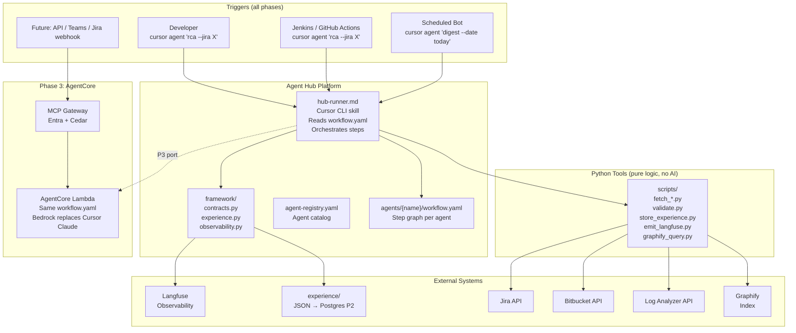
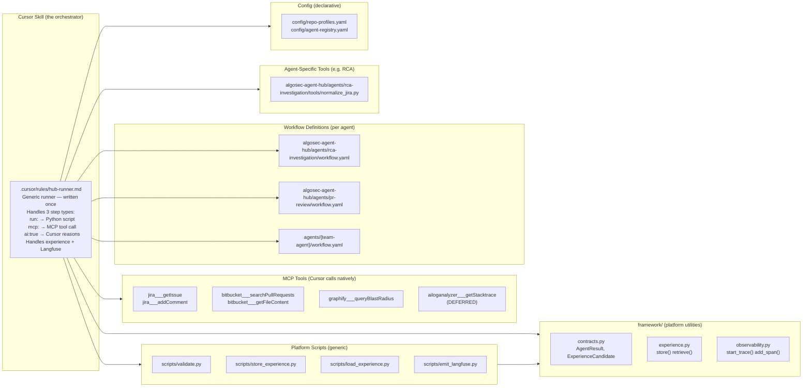
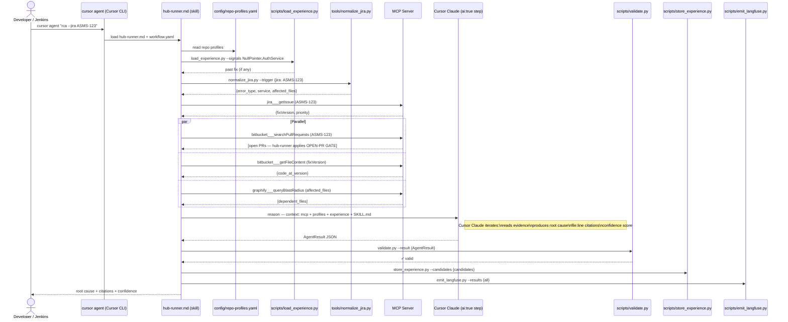
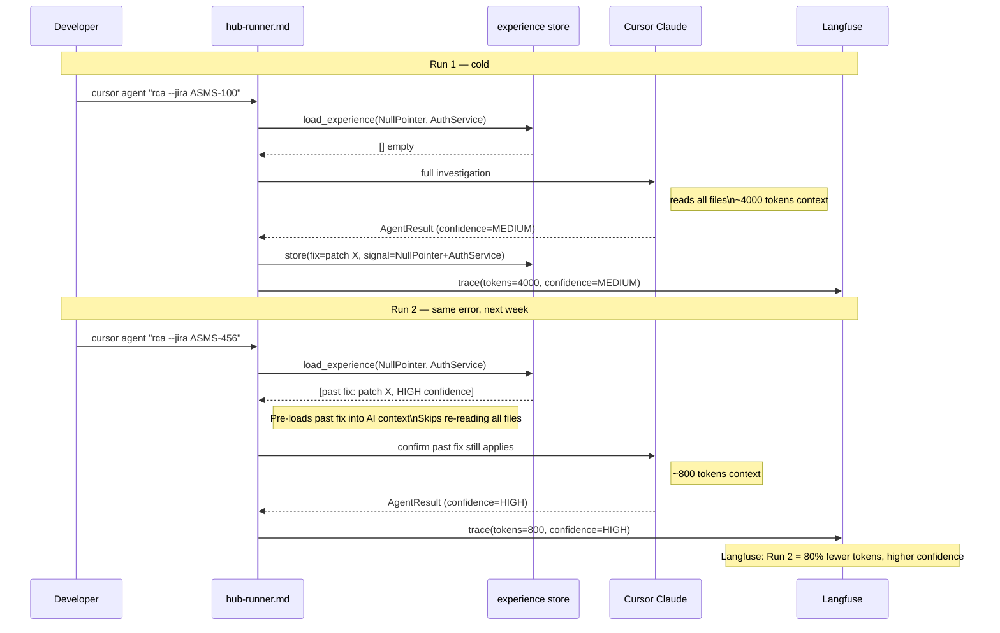
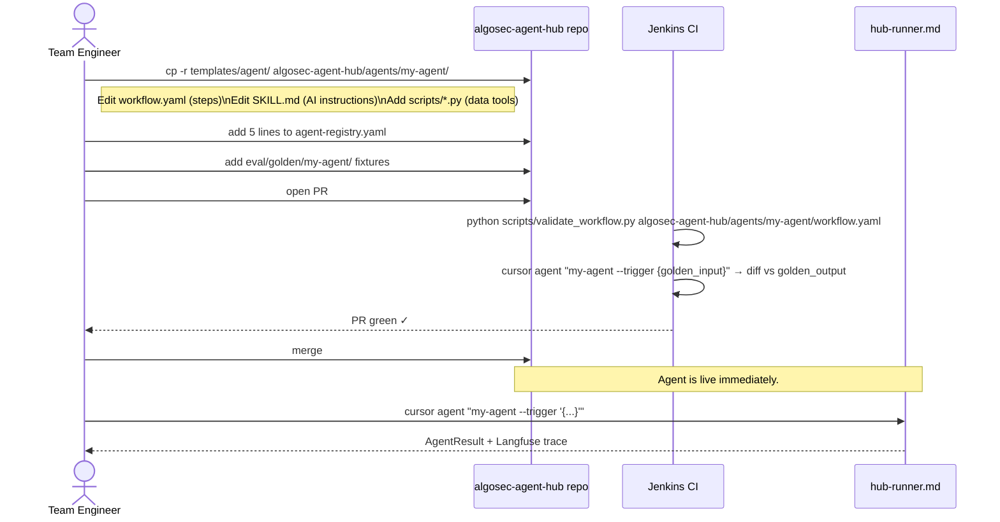
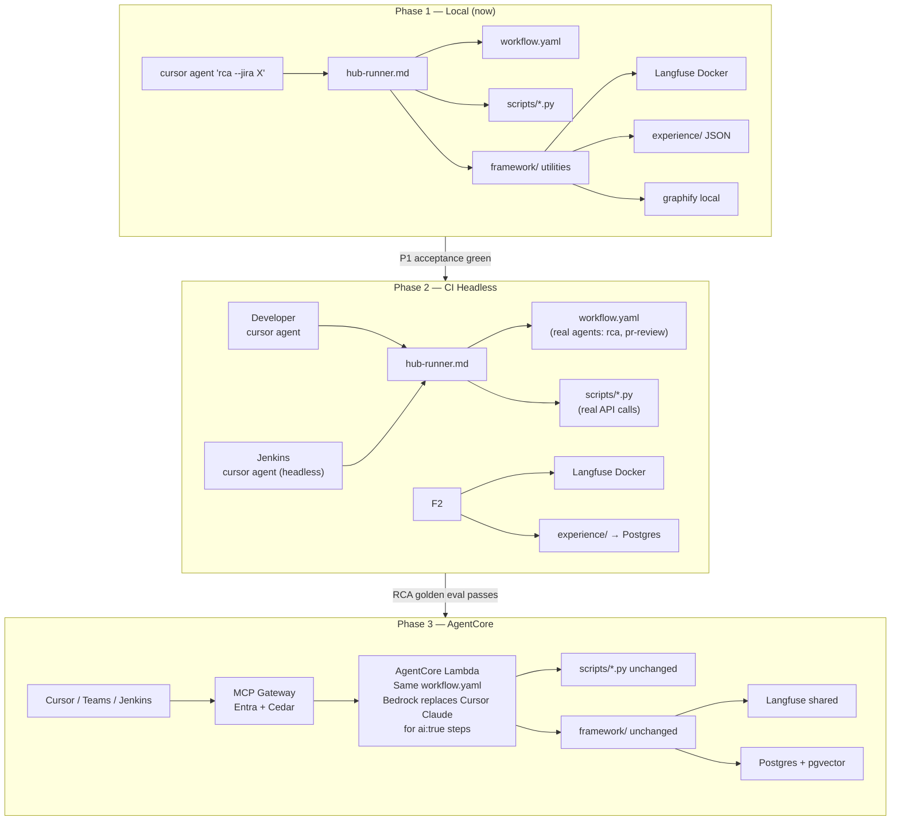

# Agent Hub — High Level Design

> **Locked architecture.** Full journey Phase 1 → Phase 3+.
> Design principle: YAML declares, AI reasons, Python stores.

---

## 0. Three Principles

```
1. YAML declares the workflow    → readable, AI-generatable, versionable
2. Cursor CLI IS the AI          → no Bedrock setup; best reasoning; headless-capable
3. Python is pure plumbing       → contracts, experience store, Langfuse, data tools
```

---

## 1. System Context



---

## 2. Component Architecture



---

## 3. The Workflow YAML Schema (GitHub Actions for AI agents)

Every agent is one YAML file. Three step types — **prefer MCP and AI over manual scripts.**

```
Step type decision tree:
  Does an MCP tool exist for this?  → use mcp:
  Does it require Cursor to reason?  → use ai: true
  Pure data/logic with no MCP?       → use run: (Python script)
```

```yaml
# algosec-agent-hub/agents/rca-investigation/workflow.yaml

id: rca-investigation
version: "1.0.0"
description: "Investigates CI failures, support tickets, customer incidents"

input:
  sources: [jira, jenkins, manual]

# Repo context — AI extends this from graphify + Jira ticket at runtime
repo_profiles: config/repo-profiles.yaml

experience:
  signals: ["{{trigger.error_type}}", "{{trigger.service}}"]
  repo:    "{{trigger.repo}}"

steps:

  - id: normalize
    execution: sequential
    run: algosec-agent-hub/agents/rca-investigation/tools/normalize_jira.py   # TENANT tool, not platform script
    args: ["--trigger", "{{trigger}}"]

  - id: pre-check
    execution: sequential
    mcp: jira___getIssue                     # MCP: get ticket data, versions, priority
    args: {issueKey: "{{trigger.jira}}"}
    # output: {summary, description, fixVersion, affectedVersion, priority, labels}

  - id: investigate
    execution: parallel
    steps:
      - id: open-pr-gate
        mcp: bitbucket___searchPullRequests     # MCP: is a fix already in flight?
        args:
          workspace: algosec-tools
          query: "{{trigger.jira}}"
          state: OPEN
        # hub-runner OPEN-PR GATE: if OPEN PR title contains JIRA key → short-circuit

      - id: blast-radius
        mcp: graphify___queryBlastRadius     # MCP: built in P1 Step 7; fallback: scripts/graphify_query.py
        args: {files: "{{normalize.affected_files}}"}

      # DEFERRED: Log Analyzer integration via MCP
      # - id: logs
      #   mcp: ailoganalyzer___getStacktrace
      #   args: {jiraKey: "{{trigger.jira}}"}

      - id: repo-context
        mcp: bitbucket___getFileContent        # MCP: code at fixVersion — not current HEAD
        args:
          workspace: algosec-tools
          repo_slug: "{{normalize.repo}}"
          commit: "{{pre-check.fixVersion}}"
          path: "{{normalize.affected_files[0]}}"
        # hub-runner calls getFileContent once per affected file when list length > 1

  - id: reason
    execution: sequential
    ai: true                                 # Cursor reasons — iterative, file-reading
    context:
      - "{{pre-check}}"                      # ticket metadata
      - "{{investigate.open-pr-gate}}"       # open PRs
      - "{{investigate.blast-radius}}"       # what else breaks
      - "{{investigate.repo-context}}"       # code at the broken version
      - "{{experience}}"                     # past fixes for same signal
      # - "{{investigate.logs}}"             # DEFERRED
    instruction: "algosec-agent-hub/agents/rca-investigation/SKILL.md"
    # Cursor also reads config/repo-profiles.yaml to understand repo relationships

  - id: validate
    execution: sequential
    run: scripts/validate.py                 # Pydantic — enforced on AgentResult only
    args: ["--result", "{{reason.output}}"]

output:
  - channel: jira_comment
    mcp: jira___addComment                   # MCP: post comment on ticket
    when: "{{trigger.source}} == 'jira'"
    args:
      issueKey: "{{trigger.jira}}"
      body: "{{validate.output.summary}}"
    template: algosec-agent-hub/templates/rca-jira.md

  - channel: ci_blocker
    when: "{{trigger.source}} == 'jenkins'"

experience_write:
  from: "{{validate.output.experience_candidates}}"
```

### Step type reference

| Type | Syntax | When to use |
|------|--------|-------------|
| `mcp:` | `mcp: jira___getIssue` | **Primary Choice.** Jira, Bitbucket, Graphify, Log Analyzer |
| `run:` | `run: scripts/validate.py` | **Fallback Only.** Framework plumbing (validate, normalize, gates) |
| `ai: true` | `ai: true` + `context:` | Cursor reasons over collected evidence |


---

## 4. The Hub Runner Skill (written once, never changes)

```markdown
# .cursor/rules/hub-runner.md

You are the Agent Hub runner. When invoked with --agent {name} --trigger {json}:

1. Read agents/{name}/workflow.yaml
2. Read config/repo-profiles.yaml — understand which repos are relevant to this trigger
3. Run: python scripts/load_experience.py --signals "{{experience.signals}}" --repo "{{experience.repo}}"
4. Execute each step in workflow order by step type:

   STEP TYPE: run:
     → python {script} {args}  (pass outputs forward as JSON)

   STEP TYPE: mcp:
     → Call the named MCP tool natively with the given args
     → Store output as step result, pass forward as JSON
     → Prefer MCP over scripts whenever an MCP tool exists for the task

   STEP TYPE: ai: true
     → YOU reason over all listed context items
     → Load instruction file if specified (instruction:)
     → Read config/repo-profiles.yaml to understand repo relationships
     → Produce valid AgentResult JSON. Cite file:line for every claim.

   STEP TYPE: execution: parallel
     → Run all child steps concurrently, collect all outputs before proceeding

   OPEN-PR GATE (automatic — no separate script):
     → After bitbucket___searchPullRequests (or equivalent PR search MCP), inspect JSON output
     → If any OPEN PR title/branch contains the trigger JIRA key (case-insensitive) → STOP
     → Output: {status: "blocked", reason: "fix in progress", pr_url: "..."}
     → Do not continue to reason step. Do not waste tokens.

5. After ai:true or validate steps only: python scripts/validate.py --result '{output}'
   Do NOT call validate.py after run: or mcp: data steps.
   If validation fails → stop and report exact Pydantic error. Do not continue.

6. After all steps: python scripts/store_experience.py --candidates '{experience_candidates}'
7. After all steps: python scripts/emit_langfuse.py --run_id '{run_id}' --results '{all_results}'
8. Route output per workflow output block:
   - If output channel has mcp: → call that MCP tool to post/update
   - Otherwise format per template and display

Rules:
- Always prefer mcp: tools over run: scripts when both could do the task
- Never skip validate.py on AgentResult steps. Never skip emit_langfuse.py.
- Never invent data. Only use what scripts and MCP tools return.
- Never guess file paths. Read repo-profiles.yaml or query graphify_query.py.
- If any tool fails, report the exact error output. Do not retry silently.
```

---

## 5. Sequence: RCA — Full End-to-End



---

## 6. Sequence: Experience Flywheel



---

## 7. Sequence: Team Contributing a New Agent



---

## 8. Deployment Progression



---

## 9. Memory Architecture

| Tier | What | Storage | Phase |
|------|------|---------|-------|
| Structural | Code imports, blast radius | Graphify JSON | P1 |
| Episodic | Error signature → past fix | JSON files | P1 |
| Episodic (scaled) | Same, SQL-queryable | Postgres JSONB | P2 |
| Semantic | Similarity on signals | Postgres + pgvector | P3 research |
| Live context | Jira, Bitbucket, Confluence | MCP Gateway tools | P3 |

---

## 10. Full Phase Summary

| Phase | Milestone | Gate |
|-------|-----------|------|
| **P1** | hub-runner.md + framework/ + mock workflow | Acceptance test green |
| **P2a** | Real RCA agent (workflow.yaml + real scripts) | RCA golden eval passes |
| **P2b** | Real PR Review agent | PR golden eval passes |
| **P2c** | Self-service proven: another team adds agent | Their eval passes |
| **P2d** | Postgres replaces JSON experience store | Migration test passes |
| **P3** | AgentCore Lambda + Gateway MCP + Cedar | DevOps deploy to dev |
| **P3+** | 5+ team agents registered and running | Adoption metric met |

---

## 11. What Does NOT Change Between Phases

```
AgentResult schema          → same P1 mock → P3 Lambda
workflow.yaml format        → same P1 → P3
scripts/*.py                → same P1 → P3 (only transport changes)
framework/contracts.py      → same P1 → P3
framework/experience.py     → same interface (backend swaps P1→P2)
Langfuse trace shape        → same instance P1 → P3
agent-registry.yaml format  → same P1 → P3
```

**The only thing that changes: the AI runtime.**
- P1/P2: `cursor agent` → Cursor's Claude
- P3: AgentCore Lambda → AWS Bedrock Claude

Everything else — YAML, scripts, contracts, experience, Langfuse — is written once.

---

## 12. Implementation Reference (Phase 1)

> ~150 lines of Python total. Everything else is YAML and markdown.

### framework/contracts.py

```python
from pydantic import BaseModel
from typing import Literal

class RepoContext(BaseModel):
    repo: str
    branch: str
    pr_id: str | None = None
    relevant_files: list[str] = []

class ExperienceCandidate(BaseModel):
    trigger_signals: list[str]
    resolution: str
    source_run_id: str
    confidence: Literal["HIGH", "MEDIUM"]
    repo: str

class Citation(BaseModel):
    file: str
    line: int
    repo: str
    branch: str

class AgentResult(BaseModel):
    agent: str
    task_id: str
    status: Literal["success", "partial", "failed"]
    confidence: Literal["HIGH", "MEDIUM", "LOW", "UNKNOWN"]
    repos_inspected: list[RepoContext] = []
    summary: str
    blockers: list[str] = []
    suggestions: list[str] = []
    experience_candidates: list[ExperienceCandidate] = []
    citations: list[Citation] = []
    tokens_used: int = 0
    duration_seconds: float = 0.0
```

### framework/experience.py (~50 lines)

```python
import hashlib, json
from pathlib import Path
from framework.contracts import ExperienceCandidate

STORE = Path("experience")

def _key(signals: list[str], repo: str) -> str:
    return hashlib.sha256((repo + "|" + "|".join(sorted(signals))).encode()).hexdigest()[:16]

def retrieve(signals: list[str], repo: str) -> list[dict]:
    p = STORE / repo.replace("/", "_") / f"{_key(signals, repo)}.json"
    return json.loads(p.read_text()) if p.exists() else []

def store(candidates: list[ExperienceCandidate]) -> None:
    for c in candidates:
        p = STORE / c.repo.replace("/", "_")
        p.mkdir(parents=True, exist_ok=True)
        (p / f"{_key(c.trigger_signals, c.repo)}.json").write_text(c.model_dump_json(indent=2))
```

### framework/observability.py (~30 lines)

```python
from langfuse import Langfuse
_lf = Langfuse()  # reads LANGFUSE_PUBLIC_KEY + LANGFUSE_SECRET_KEY from .env

def start_trace(name: str, metadata: dict = {}) -> object:
    return _lf.trace(name=name, metadata=metadata)

def add_span(t, name: str, input: dict, output: dict) -> None:
    t.span(name=name, input=input, output=output)

def end_trace(t, output: dict) -> None:
    t.update(output=output)
```

### scripts/validate.py (called after `ai:true` / `validate` steps only — not data fetch steps)

```python
import sys, json
from framework.contracts import AgentResult

result = json.loads(sys.argv[sys.argv.index("--result") + 1])
try:
    AgentResult.model_validate(result)
    print(json.dumps({"valid": True, "result": result}))
except Exception as e:
    print(json.dumps({"valid": False, "error": str(e)}), file=sys.stderr)
    sys.exit(1)
```

### scripts/store_experience.py

```python
import sys, json
from framework.contracts import ExperienceCandidate
from framework.experience import store

candidates = json.loads(sys.argv[sys.argv.index("--candidates") + 1])
store([ExperienceCandidate.model_validate(c) for c in candidates])
print("stored", len(candidates), "experience candidates")
```

### scripts/load_experience.py

```python
import sys, json
from framework.experience import retrieve

signals = json.loads(sys.argv[sys.argv.index("--signals") + 1])  # list[str]
repo    = sys.argv[sys.argv.index("--repo") + 1]
past    = retrieve(signals, repo)
print(json.dumps({
    "experience": past,
    "experience_loaded": len(past) > 0   # ← emitted to Langfuse, visible in dashboard
}))
```

### scripts/emit_langfuse.py

```python
import sys, json
from framework.observability import start_trace, add_span, end_trace

data   = json.loads(sys.argv[sys.argv.index("--results") + 1])
run_id = sys.argv[sys.argv.index("--run_id") + 1]

t = start_trace(data["agent"], metadata={
    "run_id": run_id,
    "experience_loaded": data.get("experience_loaded", False),  # ← visible in dashboard
    "trigger": data.get("trigger", {})
})
for span in data.get("spans", []):
    add_span(t, span["name"], span["input"], span["output"])
end_trace(t, output=data.get("final_result", {}))
print("trace emitted:", run_id)
```

### algosec-agent-hub/agents/rca-investigation/tools/normalize_jira.py (Tenant Tool)

```python
import sys, json

trigger = json.loads(sys.argv[sys.argv.index("--trigger") + 1])

# Normalize any trigger source into a standard shape
normalized = {
    "jira":          trigger.get("jira"),
    "jenkins_url":   trigger.get("jenkins_url"),
    "description":   trigger.get("desc") or trigger.get("description"),
    "repo":          trigger.get("repo", "unknown"),
    "service":       trigger.get("service", "unknown"),
    "error_type":    trigger.get("error_type", "unknown"),
    "source":        trigger.get("source", "manual"),
    "affected_files": trigger.get("affected_files", []),
}

print(json.dumps(normalized))
```

### What the P3 swap looks like (AgentCore)

```python
# In AgentCore Lambda handler — replace Cursor Claude with Bedrock for ai:true steps
# scripts/*.py, contracts.py, experience.py, observability.py — all unchanged
import boto3, json

def run_ai_step(context: list[str], instruction: str) -> dict:
    prompt = open(instruction).read() + "\n\nContext:\n" + "\n".join(context)
    resp = boto3.client("bedrock-runtime").invoke_model(
        modelId="anthropic.claude-3-5-sonnet-20241022-v2:0",
        body=json.dumps({"anthropic_version": "bedrock-2023-05-31",
                         "max_tokens": 2048,
                         "messages": [{"role": "user", "content": prompt}]})
    )
    return json.loads(json.loads(resp["body"].read())["content"][0]["text"])
    # Everything else (scripts, contracts, experience) stays identical
```

---

## 13. MCP Integration, Repo Profiles, Experience Bootstrap

> Improvements derived from BugBot analysis. Prefer MCP and AI over manual engineering.

### MCP over scripts — decision matrix

| Data needed | BugBot | Agent Hub |
|---|---|---|
| Jira ticket content | Custom API call | `mcp: jira___getIssue` |
| Open PRs for ticket | `open_pr_gate.py` custom script | `mcp: bitbucket___searchPullRequests` + hub-runner OPEN-PR GATE |
| Code at specific version | Manual git or API | `mcp: bitbucket___getFileContent` (commit/ref + path) |
| Post Jira comment | Custom API call | `mcp: jira___addComment` |
| Log evidence | Custom API call | `mcp: ailoganalyzer___getStacktrace` (DEFERRED to later phase) |
| Cross-repo blast radius | Clone + grep | P1 Step 7: `mcp: graphify___queryBlastRadius`; fallback: `run: scripts/graphify_query.py` |

**Rule:** if an MCP tool exists for the task, it is the first choice. Scripts are the fallback.

---

### config/repo-profiles.yaml

Declarative, AI-readable. Hub-runner.md reads this before every run. Cursor's AI extends it at runtime using ticket context and graphify results.

```yaml
# config/repo-profiles.yaml

profiles:
  ASMS:
    description: "Algosec Management Server — main product"
    primary_repos:
      - algosec-management-server
      - algosec-policy-engine
    integration_repos:
      - integration-tests-ci
    ui_repos:
      - suite
    shared_libs:
      - angular-shared-libs

  AVC:
    description: "Algosec Violation Center"
    primary_repos:
      - algosec-violation-center
    integration_repos:
      - integration-tests-ci

  OBF:
    description: "On-Box Firewall"
    primary_repos:
      - algosec-obf

# AI extends this at runtime:
# 1. Reads Jira ticket project key → looks up profile
# 2. Queries graphify index for additional cross-repo dependencies
# 3. Merges both → full repo context passed to ai:true step
```

**Why YAML, not Python (BugBot's `PROJECT_PROFILES` dict):**
- AI-readable without code execution
- Teams edit without Python knowledge
- Not validated by `validate_workflow.py` (workflow schema only) — parse-check YAML manually in P1
- Hub-runner.md reads it natively as text

---

### Open-PR gate (hub-runner only — no tenant script)

Gate logic lives in `hub-runner.md` §OPEN-PR GATE. After `bitbucket___searchPullRequests` returns,
the runner inspects PR titles/branches for the trigger JIRA key. If matched → short-circuit before
`ai: true`. No `check_open_pr.py` — MCP output + runner rules are sufficient.

---

### algosec-agent-hub/agents/rca-investigation/tools/seed_from_bugbot.py (one-time bootstrap)

Import BugBot's years of historical resolutions into Hub's experience store. Hub starts with a full history — run 1 already has experience.

```python
"""
One-time script. Run once in Phase 2 to bootstrap experience store from BugBot history.
Reads Jira tickets labelled '666BugbotAgent-analyzed', extracts resolution + signals,
stores as ExperienceCandidate entries.
"""
import json
# mcp: jira___searchIssues → labels = 666BugbotAgent-analyzed, maxResults=500
# For each issue:
#   signals = [issue.error_type, issue.service, issue.component]
#   resolution = extract from BugBot comment (first comment with "BugBot v1")
#   store as ExperienceCandidate via framework/experience.py

from framework.contracts import ExperienceCandidate
from framework.experience import store

def seed(issues: list[dict]) -> int:
    candidates = []
    for issue in issues:
        bugbot_comment = next(
            (c for c in issue.get("comments", []) if "BugBot v" in c.get("body", "")),
            None
        )
        if not bugbot_comment:
            continue
        candidates.append(ExperienceCandidate(
            trigger_signals=[issue.get("project", ""), issue.get("error_type", "unknown")],
            resolution=bugbot_comment["body"][:500],
            source_run_id=f"bugbot-seed-{issue['key']}",
            confidence="MEDIUM",                         # BugBot = medium confidence baseline
            repo=issue.get("components", ["unknown"])[0]
        ))
    store(candidates)
    return len(candidates)

# Run: python algosec-agent-hub/agents/rca-investigation/tools/seed_from_bugbot.py --issues '{...}'
# Output: "seeded N experience candidates from BugBot history"
```

**Effect:** Hub's first real run on any known error type finds a BugBot-sourced resolution in experience store. Confidence starts at MEDIUM, improves to HIGH as Hub accumulates its own runs. BugBot's years of triage → Hub's free head start.

---

### Why this beats BugBot's architecture

```
BugBot:                              Agent Hub:
────────────────────────────────     ────────────────────────────────────────
repo_profiles.py (Python dict)   →   config/repo-profiles.yaml (AI-readable)
open_pr_gate.py (custom script)  →   mcp: bitbucket___searchPullRequests + hub-runner gate
calibrate_fs_fixes.py (manual)   →   experience flywheel (automatic every run)
No memory between runs           →   experience store seeded from BugBot history
Grep/clone for code context      →   graphify (causal) + MCP file at version
No observability                 →   Langfuse per-span, measurable improvement
```
